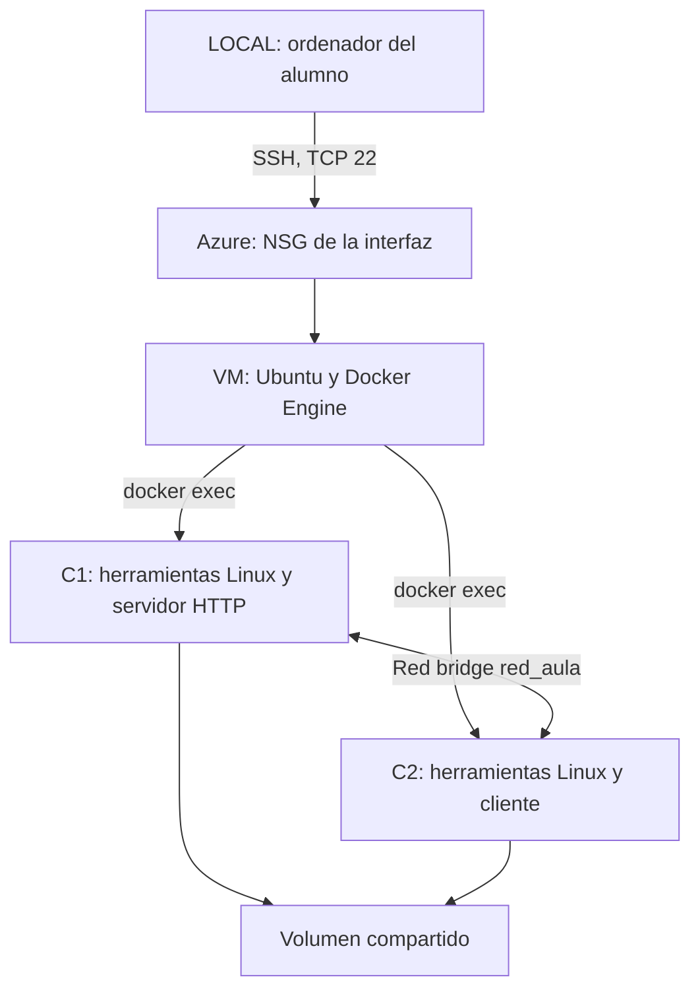
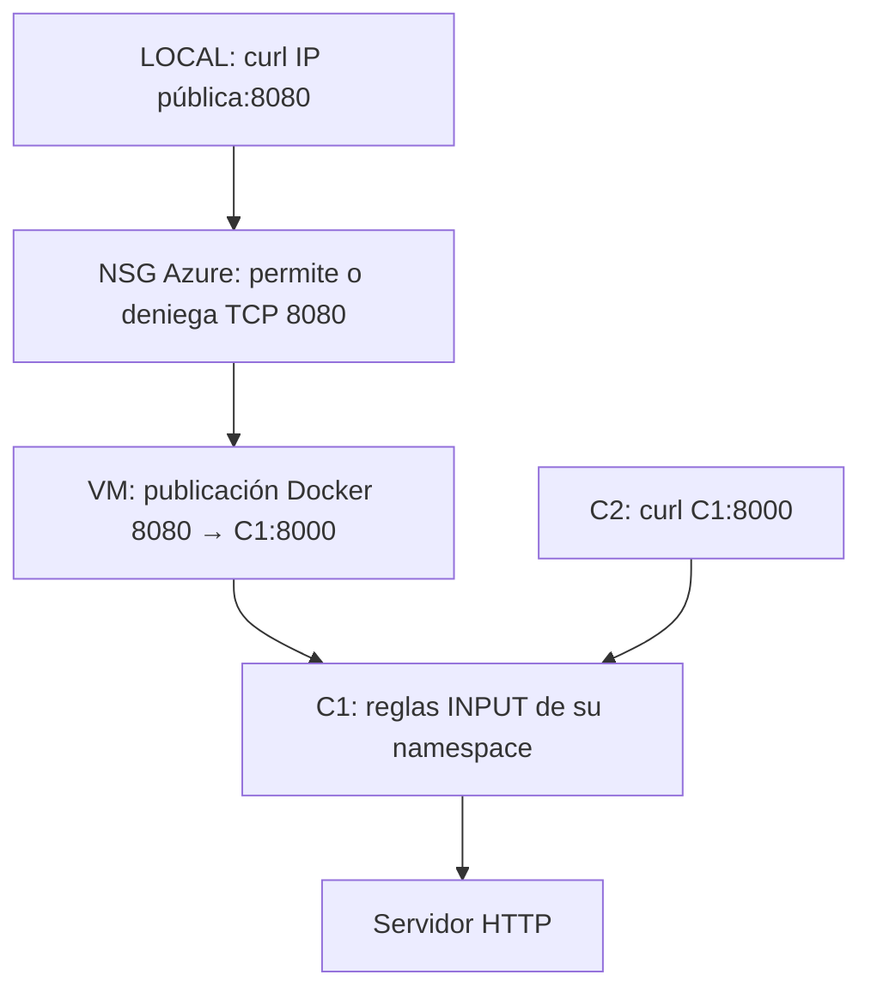
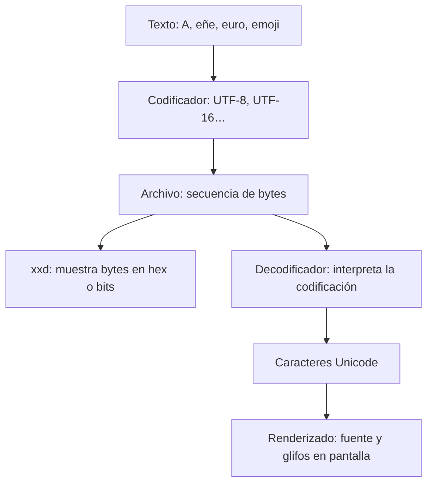

# Linux y Docker en una VM de Azure: saber dónde estamos, observar y experimentar

Adaptación didáctica de la práctica de Francisco Javier Báñez Arés. Conserva sus ejercicios de archivos, red, volumen compartido y `xxd`, y reorganiza el recorrido para alumnado principiante.

**Objetivo:** entrar por SSH en una VM Linux de Azure, crear dos contenedores, distinguir sus procesos y redes, comprobar dos capas de filtrado y entender cómo los caracteres se convierten en bytes.

**Entorno elegido:** equipo local con SSH y Azure CLI; VM Ubuntu Server 24.04 LTS; dos contenedores basados en `ubuntu:24.04`; comandos Bash. En Windows, ejecuta los bloques locales desde WSL con Azure CLI instalado, no desde PowerShell sin adaptarlos. También puedes crear la infraestructura con el portal y utilizar SSH local.

**Duración orientativa:** dos sesiones de 2 horas, más instalación. El docente puede dejar construida la imagen para ahorrar descargas. No hacen falta Kubernetes ni Docker dentro de los contenedores.

## 0. El mapa: dos entradas, un kernel Linux en la VM



- **SSH** abre una sesión en otra máquina a través de la red.
- **`docker exec`** pide a Docker ejecutar otro proceso en un contenedor existente. No es una segunda conexión SSH.
- La VM tiene su propio kernel. Los dos contenedores comparten **ese kernel** y tienen entornos de usuario y vistas aisladas de procesos, archivos y red.
- Ubuntu dentro de Docker aporta programas y bibliotecas. No implica otro kernel arrancado dentro del contenedor.
- Azure denomina **VNet** a su red virtual y **NSG, Network Security Group**, al filtro que aplicaremos. No lo confundas con una zona de disponibilidad ni con nombres de otros proveedores.

### Identificar la terminal antes de escribir

| Etiqueta en esta guía | Dónde se ejecuta | Cómo llegas | Cómo sales |
|---|---|---|---|
| **LOCAL** | Tu ordenador | Terminal local | Cierra la terminal |
| **VM** | Ubuntu en Azure | `ssh azureuser@IP` | `exit` vuelve a LOCAL |
| **C1** | Contenedor servidor | `sudo docker exec -it aula_c1 bash` desde VM | `exit` vuelve a VM |
| **C2** | Contenedor cliente | `sudo docker exec -it aula_c2 bash` desde VM | `exit` vuelve a VM |

Usaremos habitualmente comandos `docker exec` desde VM para evitar saltos ambiguos. Cuando entres de forma interactiva se indicará expresamente. **No copies la etiqueta LOCAL/VM/C1/C2 como parte del comando.**

Antes de un cambio de contexto, pregunta: «¿Qué equipo ejecutará esto? ¿Qué archivos, procesos o reglas verá?».

## 1. Crear la VM y restringir SSH

La infraestructura tiene coste. Utiliza un grupo de recursos exclusivo de esta práctica. No ejecutes su eliminación sobre un grupo compartido. La región y el tamaño dependen de la cuota de tu suscripción; el ejemplo propone una VM modesta.

**LOCAL — Bash con Azure CLI instalado y sesión autenticada:**

```bash
az login
az account show --query '{suscripcion:name,id:id}' -o table

# Cambia el sufijo para evitar colisiones entre alumnos.
RG=rg-linux-aula-alumno01
VM=vm-linux-aula
NSG=nsg-linux-aula
REGION=westeurope

# Sustituye este ejemplo por la IP PÚBLICA de salida de tu ordenador o aula.
# 203.0.113.10 es una IP de documentación: no permite acceder de verdad.
MI_CIDR=203.0.113.10/32

az group create --name "$RG" --location "$REGION"
az network nsg create --resource-group "$RG" --name "$NSG"
az network nsg rule create --resource-group "$RG" --nsg-name "$NSG" \
  --name SSH-desde-aula --priority 100 --direction Inbound --access Allow \
  --protocol Tcp --source-address-prefixes "$MI_CIDR" \
  --source-port-ranges '*' --destination-address-prefixes '*' \
  --destination-port-ranges 22

az vm create --resource-group "$RG" --name "$VM" \
  --image Ubuntu2404 --size Standard_B2s \
  --admin-username azureuser --generate-ssh-keys \
  --nsg "$NSG" --nsg-rule NONE --public-ip-sku Standard

IP_VM=$(az vm show -d --resource-group "$RG" --name "$VM" \
  --query publicIps -o tsv)
printf 'IP pública de la VM: %s\n' "$IP_VM"
ssh "azureuser@$IP_VM"
```

Comprueba la huella SSH de la VM mediante el procedimiento de tu entorno antes de aceptarla. Si la red del aula cambia de IP pública, habrá que actualizar la regla. No sustituirla por acceso global solo para resolver un error sin entenderlo.

La creación utiliza un NSG explícito y evita añadir una regla SSH abierta por defecto. En una suscripción con políticas adicionales, revisa las **reglas efectivas** de la interfaz y la subred: este laboratorio no anula políticas corporativas.

**VM — confirmar contexto y personalizar el prompt:**

```bash
hostname
whoami
cat /etc/os-release
uname -r
export PS1='[VM-AZURE] \u@\h:\w\$ '
```

`cat /etc/os-release` describe la distribución del entorno de usuario. `uname -r` muestra el kernel que está ejecutando tus procesos. No son la misma información.

## 2. Docker y una imagen preparada para aprender

**VM — instalación en una VM Ubuntu nueva:**

```bash
sudo apt update
sudo apt install -y docker.io
sudo systemctl enable --now docker
sudo docker version
```

Aquí usamos el paquete de Ubuntu. No mezcles esta vía con paquetes de otros repositorios en una VM previamente configurada. `apt update` actualiza el catálogo de paquetes; no actualiza por sí solo todos los paquetes instalados.

Usamos `sudo docker` de forma explícita. Pertenecer al grupo `docker` concede un poder muy elevado sobre el anfitrión; no es simplemente un permiso inocuo para evitar escribir `sudo`.

La imagen mínima no trae todas las herramientas. En lugar de instalarlas y perderlas al recrear el contenedor, construiremos una imagen común.

**VM:**

```bash
mkdir -p ~/aula-linux
cd ~/aula-linux
cat > Dockerfile <<'EOF'
FROM ubuntu:24.04
RUN apt-get update && apt-get install -y --no-install-recommends \
    bash ca-certificates curl iproute2 iputils-ping net-tools \
    iptables procps psmisc lsof xxd python3 file locales \
    && rm -rf /var/lib/apt/lists/*
ENV LANG=C.UTF-8
ENV LC_ALL=C.UTF-8
CMD ["sleep", "infinity"]
EOF
sudo docker build -t aula-linux:1 .
```

- `FROM`: entorno inicial.
- `RUN`: instala herramientas al construir la imagen.
- `ENV`: configura el entorno por defecto. No convierte archivos a UTF-8.
- `CMD`: proceso principal al arrancar el contenedor. Aquí `sleep infinity` lo mantiene activo para practicar.
- `aula-linux:1` es una etiqueta local, no una garantía de inmutabilidad. Para reproducibilidad estricta se registran también los digests y las versiones de paquetes.

En Ubuntu 24.04 **`xxd` sí existe como paquete independiente**. No es necesario afirmar que siempre forma parte exclusivamente de `vim-common`.

## 3. Crear red, volumen y dos contenedores

**VM:**

```bash
sudo docker network create red_aula
sudo docker volume create aula_compartido

sudo docker run -d --name aula_c1 --hostname c1 --network red_aula \
  --cap-add NET_ADMIN \
  --mount type=volume,source=aula_compartido,target=/compartido \
  -p 8080:8000 aula-linux:1

sudo docker run -d --name aula_c2 --hostname c2 --network red_aula \
  --mount type=volume,source=aula_compartido,target=/compartido \
  aula-linux:1

sudo docker ps
sudo docker network inspect red_aula
```

Solo C1 recibe `NET_ADMIN` porque allí modificaremos reglas de red. No utilizamos `--privileged`, `--network host` ni montamos el socket Docker. La capacidad permite administrar la red de su namespace; no convierte al contenedor en una máquina virtual independiente.

La publicación `-p 8080:8000` permite alcanzar el puerto 8000 de C1 a través del puerto 8080 de la VM. Docker suele publicarlo en todas las interfaces del host; el NSG sigue controlando la entrada externa. Por ahora no hemos permitido ese puerto en Azure. El ejercicio utiliza IPv4.

**VM — obtener las IP de la red correcta:**

```bash
IP1=$(sudo docker inspect -f '{{.NetworkSettings.Networks.red_aula.IPAddress}}' aula_c1)
IP2=$(sudo docker inspect -f '{{.NetworkSettings.Networks.red_aula.IPAddress}}' aula_c2)
printf 'C1=%s C2=%s\n' "$IP1" "$IP2"
```

No recorremos todas las redes concatenando direcciones. Una IP puede cambiar al recrear un contenedor: vuelve a ejecutar estas asignaciones después de recrearlo.

### Variables: una trampa habitual

**VM:**

```bash
MENSAJE='Hola desde la VM'
sudo docker exec aula_c1 printenv MENSAJE
# No aparece: la variable de Bash no se transmitió al contenedor.
sudo docker exec -e MENSAJE="$MENSAJE" aula_c1 printenv MENSAJE
# Ahora aparece, para este proceso creado por exec.
```

`docker exec aula_c1 ping "$IP2"` funciona porque el shell de la VM sustituye `$IP2` **antes** de llamar a Docker. En cambio, si entras con `docker exec -it ... bash`, ese nuevo shell no recibe automáticamente tus variables de la VM. Las variables de entorno no son un almacén seguro de secretos.

## 4. Orientación: archivos, kernel y aislamiento

**VM — entrar en C1:**

```bash
sudo docker exec -it aula_c1 bash
```

**C1:**

```bash
export PS1='[C1] \u@\h:\w\$ '
hostname
whoami
id
pwd
cat /etc/os-release
uname -r
ps -p 1 -o pid,comm,args
```

El kernel coincide con el de la VM. El hostname y la lista de procesos no tienen por qué coincidir. PID 1 será `sleep infinity`, no necesariamente `systemd`. Por eso `systemctl` dentro de esta imagen no es la forma de gestionar servicios.

### Archivos y permisos con intención

**C1:**

```bash
mkdir -p /root/practica/documentos
cd /root/practica
printf 'Hola, Linux\nSegunda linea\n' > documentos/mensaje.txt
ls -lah documentos
pwd
cat documentos/mensaje.txt
cp documentos/mensaje.txt documentos/copia.txt
mv documentos/copia.txt documentos/renombrado.txt
chmod 640 documentos/mensaje.txt
ls -l documentos/mensaje.txt
printf 'Tercera linea\n' >> documentos/mensaje.txt
head -n 2 documentos/mensaje.txt
grep -n 'linea' documentos/mensaje.txt
sed 's/Linux/Docker/' documentos/mensaje.txt
cat documentos/mensaje.txt
```

`640`: propietario lee/escribe, grupo lee, otros sin acceso. No todos los archivos necesitan permiso de ejecución. En un directorio, `x` permite atravesarlo; `r` permite listar nombres. Trabajar como root puede ocultar problemas de permisos que sí afectan a usuarios normales. La imagen contiene también cuentas de sistema: no existe exclusivamente root.

`sed` sin `-i` muestra una transformación pero no modifica el archivo. `>` reemplaza el contenido; `>>` añade. Una tubería `|` conecta la salida de un programa con la entrada de otro.

```bash
printf 'ana 8\nluis 12\nmarta 15\n' > notas.txt
awk '$2 >= 10 {print $1}' notas.txt
ls -ali
exit
```

**De vuelta en VM.** `exit` termina el Bash creado por `exec`; C1 sigue vivo porque su proceso principal es `sleep infinity`. Si terminase el proceso principal del contenedor, el contenedor se detendría.

### Volumen compartido: mismos datos, distintos procesos

**VM:**

```bash
sudo docker exec aula_c1 bash -c 'printf "Escribe C1\n" > /compartido/mensaje.txt'
sudo docker exec aula_c2 cat /compartido/mensaje.txt
sudo docker exec aula_c2 bash -c 'printf "Responde C2\n" >> /compartido/mensaje.txt'
sudo docker exec aula_c1 cat /compartido/mensaje.txt
```

Las comillas mantienen la redirección dentro del contenedor. Sin `bash -c`, un `>` escrito fuera podría ejecutarse en la VM.

`/root/practica` está en la capa escribible de C1: sobrevive a parar/arrancar ese contenedor, pero no a borrarlo. `/compartido` está en un volumen separado. El volumen no es una copia de seguridad y compartirlo no resuelve por sí solo escrituras concurrentes.

## 5. Procesos: ver, identificar, observar y señalizar

**VM — comparar vistas:**

```bash
ps -eo pid,ppid,user,stat,comm --sort=pid | head -n 20
sudo docker exec aula_c1 ps aux
sudo docker top aula_c1
sudo docker stats --no-stream aula_c1 aula_c2
```

La VM puede observar los procesos de sus contenedores. C1 tiene su propia vista de PID. El mismo proceso puede tener un PID distinto dentro y fuera del contenedor. `docker top` muestra procesos desde la perspectiva del anfitrión.

| Campo | Significado |
|---|---|
| PID | Identificador de proceso en esa vista |
| PPID | Identificador del padre |
| USER | Usuario del proceso |
| STAT | Estado, por ejemplo ejecutable o esperando |
| %CPU / %MEM | Indicadores de utilización, con límites de interpretación |
| COMMAND | Programa y argumentos |

`ps` es una fotografía; `top` actualiza la observación. El porcentaje de CPU de `ps` no equivale exactamente a la medida instantánea de `top`.

**VM — entrar en C2:**

```bash
sudo docker exec -it aula_c2 bash
```

**C2 — un proceso inofensivo que controlamos:**

```bash
sleep 300 &
PID_PRUEBA=$!
printf 'PID creado: %s\n' "$PID_PRUEBA"
jobs -l
ps -p "$PID_PRUEBA" -o pid,ppid,stat,etime,args
kill -STOP "$PID_PRUEBA"
ps -p "$PID_PRUEBA" -o pid,stat,args
kill -CONT "$PID_PRUEBA"
kill -TERM "$PID_PRUEBA"
wait "$PID_PRUEBA"
```

`&` lanza en segundo plano; `$!` conserva su PID; `jobs` conoce los trabajos de **este shell**. STOP pausa, CONT reanuda y TERM solicita finalizar. `wait` puede terminar con estado distinto de cero porque el proceso recibió una señal: es esperado. `kill` envía señales; no siempre «mata» inmediatamente. KILL (`-9`) es último recurso porque no permite limpieza normal.

```bash
ps -eo pid,ppid,pcpu,pmem,args --sort=-pcpu | head -n 10
ps aux | awk 'NR > 1 && ($3 > 10 || $4 > 10)'
ps aux | awk 'NR > 1 && ($3 > 10 && $4 > 10)'
top
```

Sal de `top` con `q`. En `awk`, `||` significa «una condición o la otra» y `&&` exige ambas. Es posible que no aparezca ningún proceso: no vamos a forzar carga para fabricar un resultado.

```bash
df -h
du -sh /root
free -h
exit
```

**VM:** `free` y `df` dentro de un contenedor no siempre representan una cuota exclusiva asignada a él. Para límites y consumo del contenedor observa también `docker stats` y su configuración de cgroups.

## 6. Red: separar interfaz, ruta, DNS, puerto y servicio

**VM:**

```bash
sudo docker exec aula_c1 ip -br addr
sudo docker exec aula_c1 ip route
sudo docker exec aula_c1 ifconfig -a
sudo docker exec aula_c1 cat /etc/resolv.conf
sudo docker exec aula_c1 getent hosts aula_c2
sudo docker exec aula_c1 ping -c 3 aula_c2
```

| Comando | Pregunta que responde |
|---|---|
| `ip -br addr` | ¿Qué interfaces e IP tengo? |
| `ip route` | ¿Por dónde envío un paquete hacia otra red? |
| `ifconfig -a` | Vista clásica de interfaces; `ip` es la herramienta moderna |
| `getent hosts nombre` | ¿Puedo resolver este nombre a una dirección? |
| `ping -c 3 destino` | ¿Hay respuesta ICMP? |
| `ss -lntp` | ¿Qué procesos escuchan en puertos TCP? |
| `curl` | ¿Responde el servicio HTTP? |

`lo` es loopback. `127.0.0.1` dentro de C2 apunta a C2, no a la VM ni a C1. `eth0` suele ser su interfaz en la red bridge. La resolución por nombre de contenedor la proporciona Docker en esta red creada por el usuario.

**Un ping fallido no demuestra que HTTP esté caído; un ping correcto no demuestra que HTTP funcione. ICMP no tiene puertos TCP/UDP.**

### Arrancar un pequeño servidor HTTP en C1

**VM:**

```bash
sudo docker exec aula_c1 mkdir -p /www
sudo docker exec aula_c1 bash -c 'printf "Hola desde C1\n" > /www/index.html'
sudo docker exec -d aula_c1 python3 -u -m http.server 8000 --bind 0.0.0.0 --directory /www
sudo docker exec aula_c1 ss -lntp
sudo docker exec aula_c1 lsof -iTCP:8000 -sTCP:LISTEN
sudo docker exec aula_c2 curl --noproxy '*' --max-time 4 http://aula_c1:8000/
curl --noproxy '*' --max-time 4 http://127.0.0.1:8080/
```

Resultado esperado en las dos últimas consultas: `Hola desde C1`. Si repites el arranque del servidor cuando ya escucha, el segundo proceso fallará por puerto ocupado; verifica con `ss` en lugar de arrancar copias.

El servidor escucha en las interfaces de C1 con `0.0.0.0`. Si escuchase exclusivamente en `127.0.0.1` dentro de C1, los otros contenedores no podrían acceder por su IP bridge.

`exec -d` deja el proceso ejecutándose sin ocupar la terminal. `docker logs` recoge normalmente la salida del proceso principal y su configuración de logging; no debe asumirse que recoja la salida de cualquier `exec -d`. Para esta práctica comprobamos el proceso con `ps`/`ss` y el servicio con `curl`.

## 7. Las dos capas de seguridad: qué tráfico cruza cada una



**Ruta externa:** LOCAL → NSG → publicación Docker → filtro de C1 → servidor.

**Ruta interna:** C2 → red bridge local de la VM → filtro de C1 → servidor. No sale a la red virtual de Azure; el NSG no filtra ese intercambio interno en esta topología.

La VM también tiene reglas de Netfilter para publicar y reenviar puertos. No las confundimos con las reglas de C1. El tráfico reenviado hacia contenedores normalmente no se controla simplemente añadiendo una regla a `INPUT` de la VM. La capa de SO de este ejercicio se prueba **dentro del namespace de red de C1**, ejecutada por el kernel compartido de la VM.

### Experimento A: Azure impide entrar, pero C2 sí accede

Abre otra terminal **LOCAL**, conservando el SSH abierto en la anterior. Si es un shell nuevo, vuelve a definir `RG`, `VM`, `NSG`, `MI_CIDR` e `IP_VM` con los mismos valores; las variables no se sincronizan entre terminales.

**LOCAL:**

```bash
curl --noproxy '*' --connect-timeout 3 --max-time 5 "http://$IP_VM:8080/"
```

Con el NSG de esta práctica y sin una regla que permita 8080, esperamos timeout. Si responde, revisa las reglas efectivas: existe otra autorización o no se está usando el NSG previsto. En **VM**, repite `sudo docker exec aula_c2 curl --max-time 4 http://aula_c1:8000/`: debe responder.

**LOCAL — autorizar solo al origen del aula:**

```bash
az network nsg rule create --resource-group "$RG" --nsg-name "$NSG" \
  --name HTTP-aula --priority 200 --direction Inbound --access Allow \
  --protocol Tcp --source-address-prefixes "$MI_CIDR" \
  --source-port-ranges '*' --destination-address-prefixes '*' \
  --destination-port-ranges 8080

curl --noproxy '*' --connect-timeout 3 --max-time 5 "http://$IP_VM:8080/"
```

Espera a que la regla se aplique y repite si hace falta. Ahora debe responder. Un NSG es stateful: los cambios pueden no cortar conexiones ya establecidas. Para observar una regla nueva, abre conexiones nuevas; no juzgues solo una sesión persistente.

### Experimento B: bloquear ping de C2 sin bloquear HTTP

Ejecutaremos `iptables` en C1 **desde VM**, para conservar las variables de IP y no equivocarnos de namespace.

**VM:**

```bash
# Recalcular las IP antes de usar reglas basadas en direcciones.
IP1=$(sudo docker inspect -f '{{.NetworkSettings.Networks.red_aula.IPAddress}}' aula_c1)
IP2=$(sudo docker inspect -f '{{.NetworkSettings.Networks.red_aula.IPAddress}}' aula_c2)
sudo docker exec aula_c2 ping -c 3 "$IP1"

sudo docker exec aula_c1 iptables -I INPUT 1 -p icmp --icmp-type echo-request -s "$IP2" -j DROP
sudo docker exec aula_c2 ping -c 3 -W 1 "$IP1"
sudo docker exec aula_c2 curl --noproxy '*' --max-time 4 http://aula_c1:8000/
sudo docker exec aula_c1 iptables -L INPUT -n -v --line-numbers

sudo docker exec aula_c1 iptables -D INPUT -p icmp --icmp-type echo-request -s "$IP2" -j DROP
sudo docker exec aula_c2 ping -c 3 "$IP1"
```

Predice antes de ejecutar: ping falla, HTTP sigue funcionando, y al quitar la regla vuelve ping. El bloqueo pertenece a C1, el origen bloqueado es C2 y la prueba se lanza **desde C2 hacia C1**.

| Fragmento | Significado |
|---|---|
| `-I INPUT 1` | Insertar al principio de la cadena de entrada |
| `-p icmp --icmp-type echo-request` | Seleccionar solicitudes de ping IPv4 |
| `-s "$IP2"` | Seleccionar la IP de origen C2 |
| `-j DROP` | Descartar sin contestar |
| `-D INPUT ...` | Borrar esa regla exacta |
| `-n -v` | Mostrar direcciones numéricas y contadores |

Los contadores permiten comprobar si el tráfico coincide con la regla. No ejecutes la inserción repetidamente sin borrar: crearías duplicados. `-D` elimina una coincidencia por ejecución.

### Experimento C: Azure permite HTTP, pero Linux lo bloquea

**VM:**

```bash
sudo docker exec aula_c1 iptables -I INPUT 1 -p tcp --dport 8000 -j DROP
sudo docker exec aula_c2 curl --noproxy '*' --max-time 4 http://aula_c1:8000/
sudo docker exec aula_c1 ss -lntp
sudo docker exec aula_c1 iptables -L INPUT -n -v --line-numbers
```

**LOCAL:**

```bash
curl --noproxy '*' --connect-timeout 3 --max-time 5 "http://$IP_VM:8080/"
```

Las dos consultas deben fallar, aunque el proceso siga escuchando y Azure permita 8080. C1 ve el puerto **8000**, porque Docker ya ha traducido la publicación. Bloqueamos todos los orígenes para no depender de qué IP aparezca tras NAT o un proxy de Docker.

**VM — restaurar:**

```bash
sudo docker exec aula_c1 iptables -D INPUT -p tcp --dport 8000 -j DROP
sudo docker exec aula_c2 curl --noproxy '*' --max-time 4 http://aula_c1:8000/
```

**LOCAL:** repite el `curl` a la IP pública; vuelve a responder.

| Estado del laboratorio | Desde LOCAL | Desde C2 |
|---|---|---|
| NSG sin permitir 8080; sin bloqueo en C1 | Falla | HTTP funciona |
| NSG permite 8080; sin bloqueo en C1 | HTTP funciona | HTTP funciona |
| NSG permite 8080; C1 bloquea TCP 8000 | Falla | Falla |
| C1 bloquea solo ping de C2 | HTTP funciona | Ping falla; HTTP funciona |

Son capas complementarias, no «el doble de seguridad» cuantificable. Una regla de Azure no sustituye la del SO, y una regla del SO no sustituye autenticación, actualización ni permisos de aplicación.

### Qué NO tocamos en este laboratorio

No hacemos `iptables -F` en la VM, no cambiamos la política global `INPUT` a DROP y no alteramos SSH. Eso puede cortar el acceso o destruir las reglas de red de Docker.

`iptables` es una interfaz de administración de Netfilter. En Ubuntu puede usar el backend `nf_tables`; compruébalo con `iptables --version`. No cambies de backend para «hacer que funcione». Con el backend iptables de Docker, el filtrado personalizado del tráfico reenviado en el host suele ubicarse en `DOCKER-USER`; con el backend nativo nftables el diseño cambia. Ese es un módulo avanzado distinto del filtro dentro de C1.

Las reglas que añadimos son temporales y no forman parte de la imagen. Al recrear el contenedor se pierden. No utilizamos persistencia automática porque queremos que la práctica sea fácil de recuperar.

## 8. `xxd`: los archivos contienen bytes, no letras dibujadas

Ahora cambiamos de problema: desde red y procesos a **representación de información**. Trabajaremos en C1 y guardaremos los ejemplos en el volumen.



**Codificar** transforma caracteres en bytes. **Decodificar** interpreta bytes según una codificación. **Renderizar** dibuja los caracteres interpretados usando fuentes y reglas gráficas. Una fuente sin el glifo necesario puede mostrar un cuadrado aunque los bytes estén bien.

Un byte tiene 8 bits. Dos dígitos hexadecimales describen un byte: `41` hex = 65 decimal = `01000001` binario. Son distintas notaciones para el **mismo valor**, no distintas codificaciones de texto.

### 8.1 ASCII, Unicode y UTF no son sinónimos

- **ASCII:** repertorio de 128 valores, definido con 7 bits; normalmente se almacena un valor en un byte. Incluye `A`, pero no `ñ`, `€` ni emojis.
- **Unicode:** asigna puntos de código, por ejemplo `U+0041` a `A`. No es una única disposición de bytes.
- **UTF-8:** codificación Unicode de 1 a 4 bytes por valor escalar; coincide con ASCII para sus 128 valores.
- **UTF-16:** usa unidades de 16 bits; muchos caracteres ocupan una unidad y otros, como este emoji, dos: un par sustituto.
- **UTF-32:** usa una unidad de 32 bits por valor escalar. Eso no garantiza que cada símbolo visual ocupe solo cuatro bytes: un símbolo puede combinar varios puntos de código.
- **LE/BE:** little-endian o big-endian, orden de los bytes en unidades de varios bytes.

### 8.2 Crear exactamente los mismos caracteres en varios formatos

**VM:**

```bash
sudo docker exec -it aula_c1 bash
```

**C1 — permanece aquí hasta terminar el apartado 8:**

```bash
mkdir -p /compartido/codificaciones
cd /compartido/codificaciones
python3 - <<'PY'
from pathlib import Path
# Escapes Unicode: el ejercicio no depende de cómo pegues la eñe o el emoji.
texto = 'A\u00f1\u20ac\U0001f600'  # A, ñ, €, cara sonriente
for cod in ['utf-8', 'utf-16le', 'utf-16be', 'utf-32le', 'utf-32be']:
    datos = texto.encode(cod)
    Path(cod + '.bin').write_bytes(datos)
    print(cod, len(datos), datos.hex(' '))
Path('ascii.txt').write_bytes('ABC'.encode('ascii'))
try:
    texto.encode('ascii')
except UnicodeEncodeError:
    print('ASCII no puede representar todo este texto: error esperado')
PY
```

No añadimos salto de línea ni BOM a estos cinco archivos.

| Codificación de `Añ€😀` | Bytes exactos en hexadecimal | Tamaño |
|---|---|---:|
| UTF-8 | `41 c3 b1 e2 82 ac f0 9f 98 80` | 10 |
| UTF-16LE | `41 00 f1 00 ac 20 3d d8 00 de` | 10 |
| UTF-16BE | `00 41 00 f1 20 ac d8 3d de 00` | 10 |
| UTF-32LE | `41 00 00 00 f1 00 00 00 ac 20 00 00 00 f6 01 00` | 16 |
| UTF-32BE | `00 00 00 41 00 00 00 f1 00 00 20 ac 00 01 f6 00` | 16 |

UTF-8 no siempre produce archivos menores que UTF-16: depende del texto. En este ejemplo coinciden en tamaño. Que dos archivos midan lo mismo no significa que tengan los mismos bytes.

### 8.3 Ver los bytes con `xxd`

**C1:**

```bash
xxd -g 1 ascii.txt
xxd -g 1 utf-8.bin
xxd -b utf-8.bin
xxd -g 1 utf-16le.bin
xxd -g 1 utf-32be.bin
wc -c *.bin
```

Ejemplo de salida para UTF-8:

```text
00000000: 41 c3 b1 e2 82 ac f0 9f 98 80  A.........
```

El espaciado exacto puede variar. A la izquierda está el **offset en hexadecimal**; en medio, los bytes; a la derecha, una vista de bytes ASCII imprimibles. **Esa columna no es un decodificador UTF-8.** La eñe aparece como dos puntos porque está representada por dos bytes no ASCII imprimibles, no porque el archivo esté corrupto.

```bash
xxd -s 1 -l 2 -g 1 utf-8.bin
```

Desde el offset 1 lee dos bytes: `c3 b1`, que juntos codifican la eñe en UTF-8. `-l` limita bytes, no caracteres. La primera fila de `xxd -b` contiene los bytes en binario; cada grupo tiene ocho bits.

### 8.4 Decodificar correctamente y provocar un error de interpretación

**C1:**

```bash
python3 - <<'PY'
from pathlib import Path
for cod in ['utf-8', 'utf-16le', 'utf-16be', 'utf-32le', 'utf-32be']:
    datos = Path(cod + '.bin').read_bytes()
    print(cod, '->', datos.decode(cod))

original = '\u00f1'.encode('utf-8')
print('Bytes de eñe UTF-8:', original.hex(' '))
print('Bien:', original.decode('utf-8'))
print('Mal, como Latin-1:', original.decode('latin-1'))
print('Puntos interpretados mal:', [f'U+{ord(c):04X}' for c in original.decode('latin-1')])
PY
```

La interpretación errónea produce U+00C3 y U+00B1 en lugar de U+00F1. Los bytes no cambiaron: cambió la regla usada para interpretarlos. Esto explica muchos textos «raros» que viajan entre ficheros, bases de datos, web y terminales.

No uses `cat utf-16le.bin` como prueba de renderizado correcto en una terminal UTF-8: la terminal no adivina esa codificación. Convierte antes:

```bash
iconv -f UTF-16LE -t UTF-8 utf-16le.bin > convertido.txt
cmp utf-8.bin convertido.txt
printf 'Si cmp no imprime nada, ambos archivos tienen los mismos bytes.\n'
file -i utf-8.bin utf-16le.bin
```

`file` utiliza heurísticas y puede no detectar el formato de archivos tan cortos. La codificación se debe conocer por contrato, metadatos o protocolo, no por adivinación infalible.

### 8.5 BOM y endianness

**C1:**

```bash
python3 - <<'PY'
from pathlib import Path
texto = 'A\u00f1'
Path('con_bom_utf16le.bin').write_bytes(b'\xff\xfe' + texto.encode('utf-16le'))
Path('con_bom_utf8.bin').write_bytes(b'\xef\xbb\xbf' + texto.encode('utf-8'))
PY
xxd -g 1 con_bom_utf16le.bin
xxd -g 1 con_bom_utf8.bin
```

`ff fe` es el BOM de UTF-16LE. `ef bb bf` es una firma BOM de UTF-8; UTF-8 no tiene problema de orden de bytes entre LE y BE y no necesita BOM para resolverlo. Algunas herramientas lo admiten y otras lo interpretan de forma inconveniente. No añadas ni elimines BOM sin conocer el formato esperado.

### 8.6 Un símbolo visible puede ser varios puntos de código

**C1:**

```bash
python3 - <<'PY'
import unicodedata
x = '\u00e9'      # é como un punto de código
z = 'e\u0301'     # e + acento combinante
for s in (x, z):
    print(s, 'puntos:', len(s), 'bytes:', s.encode('utf-8').hex(' '))
print('Iguales sin normalizar:', x == z)
print('Iguales en NFC:', unicodedata.normalize('NFC', x) == unicodedata.normalize('NFC', z))
PY
```

Pueden verse iguales, pero sus bytes y sus secuencias de puntos de código son diferentes. En Python, `len(str)` cuenta puntos de código, no necesariamente símbolos visuales. `len(bytes)` cuenta bytes. Esto afecta a búsquedas, comparaciones, longitudes y nombres de archivos.

### 8.7 Salto de línea y hexadecimal reversible

**C1:**

```bash
printf 'Hola\n' > linux.txt
printf 'Hola\r\n' > crlf.txt
xxd -g 1 linux.txt
xxd -g 1 crlf.txt
```

LF es `0a`; CRLF es `0d 0a`. Son caracteres de control representados con bytes, no letras visibles. `echo` suele añadir un salto de línea: para controlar exactamente qué bytes escribes, usa `printf` o Python.

Ahora cambia bytes sin depender de la alineación del volcado ni de sustituir textos de diferente longitud:

```bash
printf 'Hola' > original.txt
xxd -p original.txt > original.hex
cat original.hex
# Esperado: 486f6c61
sed 's/^486f6c61$/486f6c6f/' original.hex > cambiado.hex
xxd -r -p cambiado.hex > cambiado.txt
cat cambiado.txt
printf '\n'
# Esperado: Holo
xxd -p original.txt | xxd -r -p > recuperado.txt
cmp original.txt recuperado.txt
```

`xxd -p` produce hex continuo; `xxd -r -p` lo convierte en bytes. El archivo `.hex` es un archivo de texto que contiene dígitos hexadecimales, también almacenados como bytes. Cambiar solo la columna visual derecha de un volcado normal no cambia los bytes que reconstruye `xxd -r`.

No sustituimos «Docker» por «Mundo» en un volcado alineado: cambiar la longitud exige gestionar offsets y agrupaciones. Este ejemplo mantiene la longitud para aislar el concepto.

```bash
exit
```

**Estamos otra vez en VM.**

## 9. Diagnóstico: no resolver todos los fallos con más privilegios

| Síntoma | Comprobación inicial |
|---|---|
| SSH no conecta | IP pública, IP de salida del alumno, NSG efectivo, puerto 22, VM encendida |
| `docker: command not found` | ¿Estás en VM o dentro de C1? Docker solo se instaló en VM |
| `iptables: Permission denied` en C1 | ¿Se creó C1 con `NET_ADMIN`? Root solo no basta |
| `ping: command not found` | ¿Usas `aula-linux:1` o la imagen mínima original? |
| C2 resuelve C1 pero HTTP falla | `ss` en C1, proceso HTTP, puerto y reglas INPUT |
| C2 funciona y LOCAL falla | Publicación 8080, NSG, IP de origen autorizada, rutas |
| Ping falla y HTTP funciona | Puede ser un bloqueo ICMP deliberado |
| La IP variable está vacía | Shell equivocado, variable no definida o red mal nombrada |
| Texto con caracteres extraños | Bytes con `xxd`, codificación declarada, decodificador y fuente |
| `systemctl` falla dentro de C1 | El proceso principal no es systemd; es normal en este laboratorio |

Preguntas para el alumno: ¿en qué nivel sucede el fallo?, ¿qué protocolo?, ¿qué dirección y puerto?, ¿qué proceso escucha?, ¿sube el contador de la regla?

## 10. Cerrar, conservar evidencias y eliminar costes

Antes de eliminar, copia los archivos del volumen mediante C1.

**VM:**

```bash
mkdir -p ~/evidencias-linux
sudo docker cp aula_c1:/compartido/. ~/evidencias-linux/
sudo chown -R "$(id -u):$(id -g)" ~/evidencias-linux
```

**LOCAL — en otra terminal, con IP_VM definida:**

```bash
scp -r "azureuser@$IP_VM:evidencias-linux" .
```

Verifica los archivos locales. Después puedes retirar el permiso HTTP desde **LOCAL**:

```bash
az network nsg rule delete --resource-group "$RG" --nsg-name "$NSG" --name HTTP-aula
```

**VM — limpieza solo de los recursos de Docker de esta práctica:**

```bash
sudo docker rm -f aula_c1 aula_c2
sudo docker network rm red_aula
# Opcional, solo tras guardar los archivos: borra definitivamente el volumen.
sudo docker volume rm aula_compartido
exit
```

**LOCAL — revisar antes de borrar el grupo exclusivo:**

```bash
az resource list --resource-group "$RG" -o table
az group delete --name "$RG"
```

La CLI solicita confirmación. Borrar el grupo elimina todos sus recursos. Si usas `--no-wait`, que el comando termine no implica que haya terminado el borrado. Verifica después:

```bash
az group exists --name "$RG"
```

El resultado final esperado es `false`. Apagar Linux dentro de la VM no garantiza dejar de pagar cómputo; desasignar una VM tampoco elimina necesariamente costes de disco o IP. Para esta práctica efímera, borrar el grupo dedicado facilita una limpieza completa.

## 11. Entregable del alumno y respuestas de control

Entrega un pequeño informe con estas evidencias, evitando claves privadas y credenciales:

1. `hostname`, `/etc/os-release` y `uname -r` en VM y C1: explica qué coincide y por qué.
2. Un proceso observado dentro del contenedor y desde la VM: distingue los PID y los namespaces.
3. La consulta HTTP correcta desde C2 y desde LOCAL.
4. Una captura del bloqueo ICMP con HTTP funcionando y sus contadores.
5. Una captura del bloqueo TCP 8000 con el NSG permitiendo 8080.
6. Los bytes de `Añ€😀` en UTF-8 y UTF-16LE, y la explicación del tamaño.
7. Un ejemplo de decodificación equivocada y otro de normalización.
8. Evidencia de eliminación del grupo o justificación del recurso que el docente haya decidido conservar.

**Respuestas clave:** un contenedor no arranca otro kernel; `docker exec` no es SSH; ICMP no tiene puertos; 8080 pertenece a la publicación en VM y 8000 al servicio en C1; el NSG no inspecciona el tráfico bridge local entre C1 y C2; bytes, puntos de código y glifos son niveles distintos.

## Notas para el docente: mejoras respecto a la práctica de partida

- Se prepara una imagen común antes de crear contenedores, evitando reinstalar herramientas tras recrearlos.
- Se mantienen nombres y rutas coherentes: `aula_c1`, `aula_c2`, `red_aula`, `/compartido`.
- Se resuelve el alcance de variables ejecutando operaciones desde VM con argumentos explícitos.
- Se corrige la dirección de la prueba de firewall y se separa ICMP de TCP.
- Se evita describir la red Docker como absolutamente aislada: su alcance depende de publicación, NAT, rutas y reglas. La afirmación concreta aquí es que C1↔C2 en el mismo bridge no atraviesa el NSG.
- Se distingue entorno Ubuntu de kernel, y se explica por qué salir de `exec` no detiene este contenedor.
- Se amplía `xxd` con codificación, decodificación, endianness, BOM, normalización y renderizado.
- Se sustituye la edición frágil de un volcado por una transformación hex reversible de longitud controlada.

## Referencias y comprobaciones

- [Azure: NSG](https://learn.microsoft.com/en-us/azure/virtual-network/network-security-groups-overview)
- [Azure CLI: reglas de NSG](https://learn.microsoft.com/en-us/cli/azure/network/nsg/rule)
- [Azure CLI: crear VM](https://learn.microsoft.com/en-us/cli/azure/vm)
- [Docker: filtrado y cortafuegos](https://docs.docker.com/engine/network/packet-filtering-firewalls/)
- [Docker: reglas iptables](https://docs.docker.com/engine/network/firewall-iptables/)
- [Docker: backend nftables](https://docs.docker.com/engine/network/firewall-nftables/)
- [Ubuntu 24.04: paquete xxd](https://packages.ubuntu.com/noble/xxd)
- [Python: Unicode HOWTO](https://docs.python.org/3/howto/unicode.html)

Se ha comprobado localmente la sintaxis de los 42 bloques Bash, ejecutado los ejemplos Python de codificación y verificado las cinco secuencias de bytes de la tabla. No se ha ejecutado `xxd` en este entorno de preparación, donde no está instalado. Las instrucciones de Azure y los experimentos de red requieren ejecutarse en la suscripción y VM del aula: no se han desplegado recursos ni comprobado sus políticas desde este documento.
