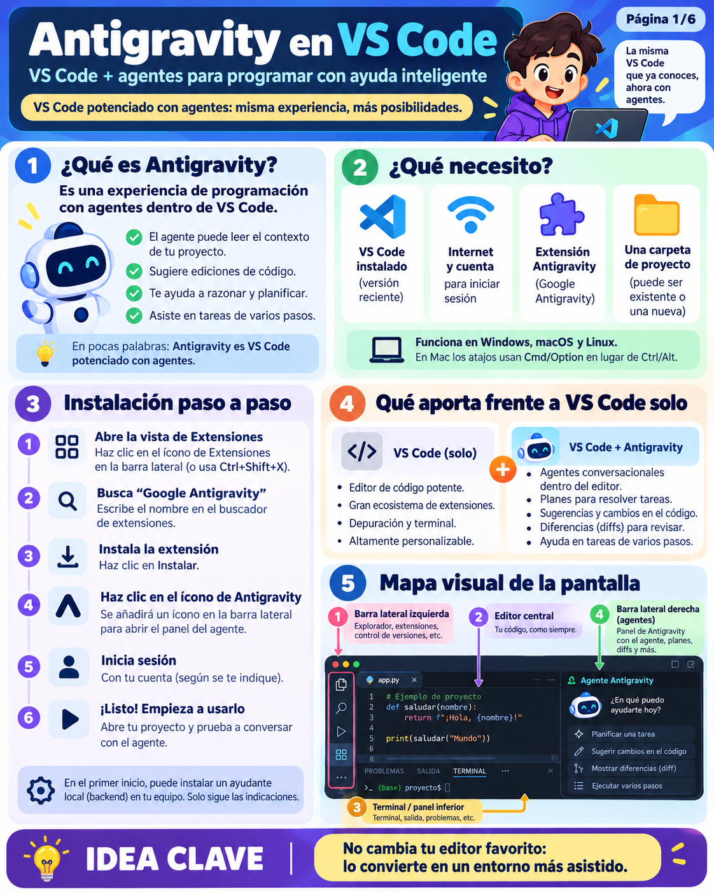
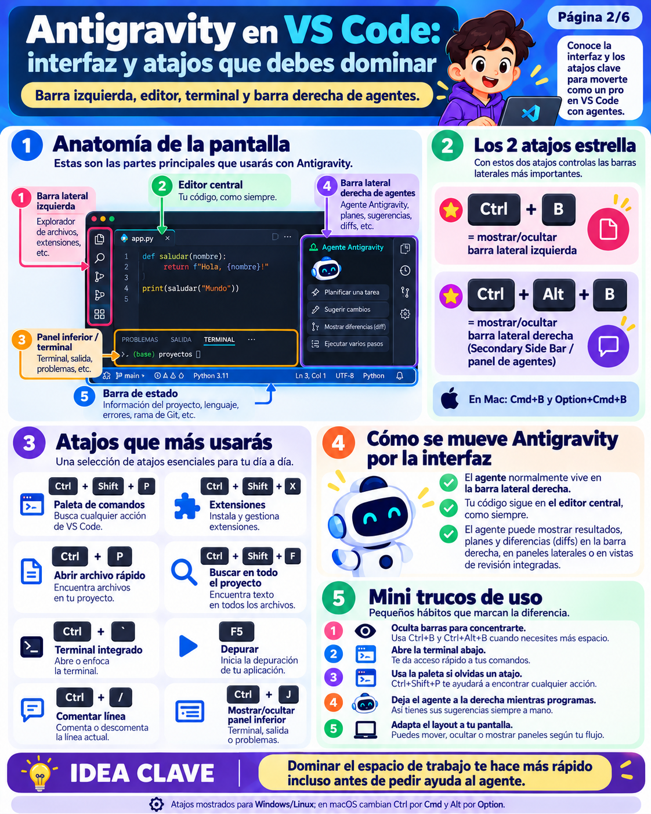
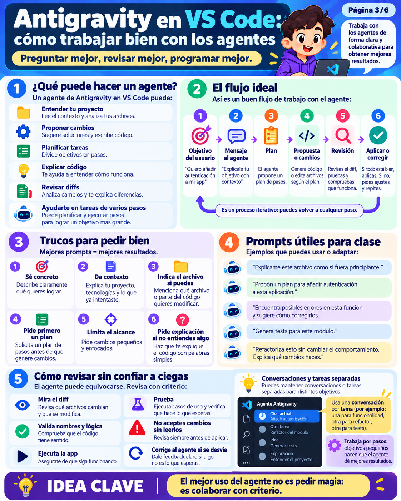
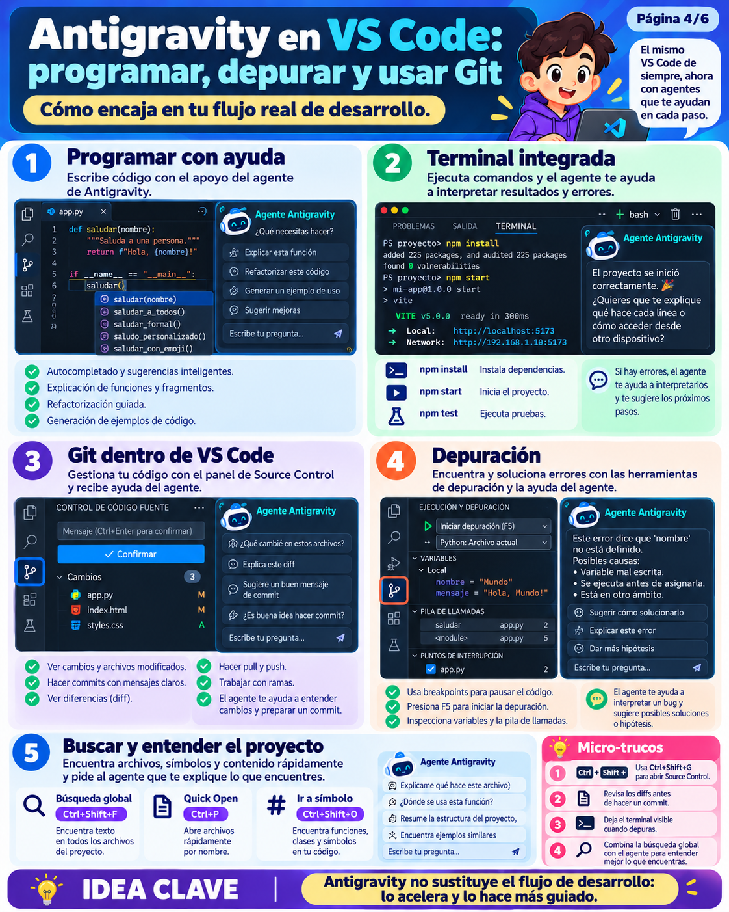
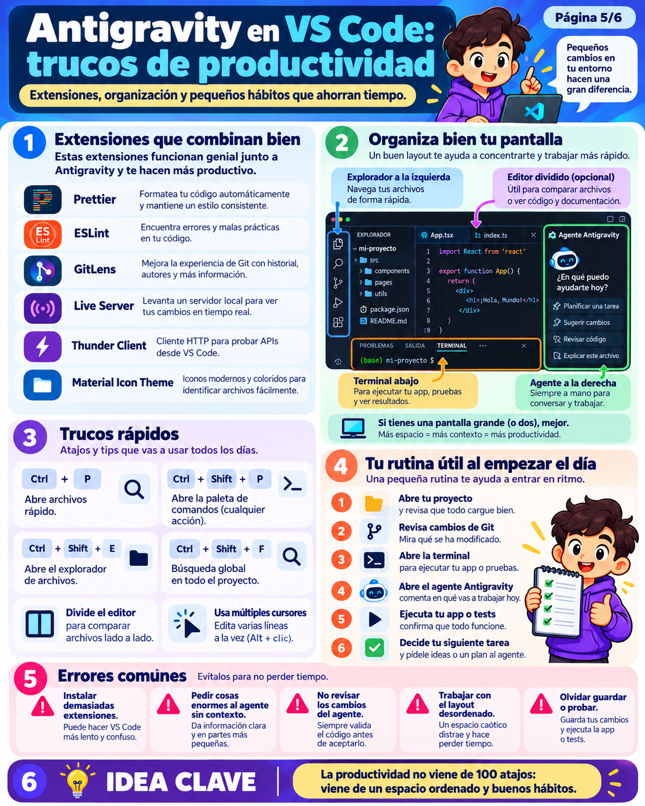
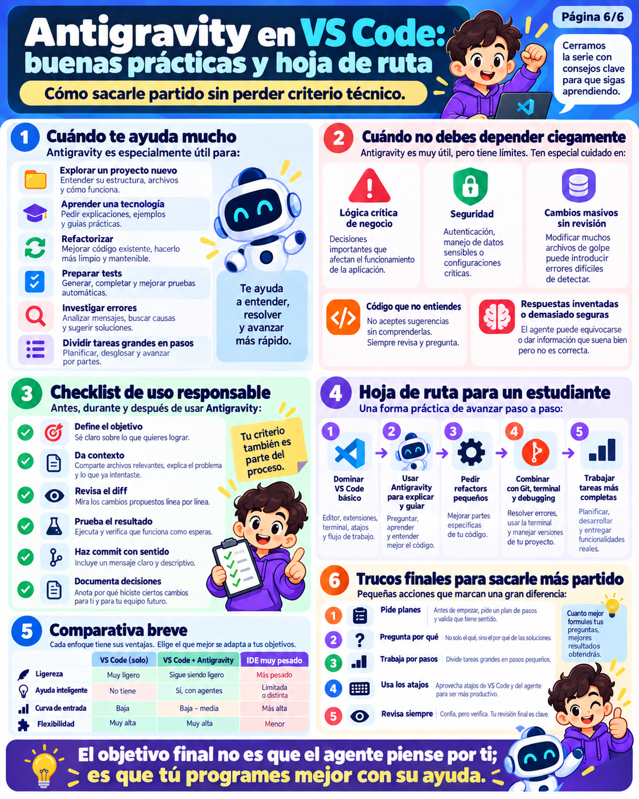

# 🚀 Antigravity en Visual Studio Code: El Manual Definitivo de Programación Asistida por Agentes
### *Curso Profundo, Didáctico y 100% Práctico: Arquitectura Interna, Atajos Ninja, Ventajas, Inconvenientes y Laboratorios de Código*

---

> **¿Por qué este curso es imprescindible?**  
> La inteligencia artificial ha transformado el desarrollo de software, pero la mayoría de programadores la utilizan de forma ingenua: copian y pegan código en una ventana de navegador web sin contexto de su repositorio, aceptan sugerencias a ciegas sin revisar las diferencias (*diffs*) o sufren porque la IA "se olvida" de los archivos de su proyecto.
>
> **Google Antigravity** no es un chatbot web ordinario: es un **entorno de agentes autónomos integrado en el corazón de Visual Studio Code**. Conoce el árbol de archivos de tu repositorio, puede leer y escribir código de forma quirúrgica, ejecuta diagnósticos en la terminal integrada y colabora contigo en tiempo real.
>
> Este manual te enseñará **cómo funcionan las tripas de Antigravity**, cómo gobernar la interfaz sin tocar el ratón gracias a atajos esenciales como `Ctrl + J`, `Ctrl + B` y `Ctrl + Alt + B`, y sobre todo, cómo desarrollar un **criterio técnico riguroso** entendiendo honestamente sus enormes ventajas y sus peligrosos inconvenientes.

---

## 🎨 Serie Visual Oficial: Antigravity en VS Code (6 Láminas)

Este curso se apoya directamente en las 6 láminas infográficas de alta resolución incluidas en este módulo:

1. **[Lámina 1: Fundamentos e Instalación](./antigravity_ide1.png)** — ¿Qué es un agente, qué necesitas y mapa visual de la pantalla?
2. **[Lámina 2: Interfaz y Atajos Maestros](./antigravity_ide2.png)** — El trío de barras, atajos de navegación y control de layout.
3. **[Lámina 3: Flujo de Trabajo y Técnicas de Consulta](./antigravity_ide3.png)** — El ciclo de 6 pasos, formulación de prompts y revisión con criterio.
4. **[Lámina 4: Integración Real: Código, Terminal, Git y Debug](./antigravity_ide4.png)** — Sinergia total en tu flujo de desarrollo cotidiano.
5. **[Lámina 5: Productividad, Extensiones y Hábitos](./antigravity_ide5.png)** — La rutina de inicio, configuración del entorno y errores comunes.
6. **[Lámina 6: Buenas Prácticas, Riesgos y Hoja de Ruta](./antigravity_ide6.png)** — Cuándo delegar, riesgos de seguridad, alucinaciones y checklist responsable.

---

## 🧭 Índice del Curso

1. [Módulo 1: Las Tripas de Antigravity (Cómo piensa y funciona por dentro)](#módulo-1-las-tripas-de-antigravity-cómo-piensa-y-funciona-por-dentro)
2. [Módulo 2: Instalación, Requisitos y Primer Contacto](#módulo-2-instalación-requisitos-y-primer-contacto)
3. [Módulo 3: El Gran Trío del Layout y Atajos de Teclado Imprescindibles](#módulo-3-el-gran-trío-del-layout-y-atajos-de-teclado-imprescindibles)
4. [Módulo 4: Las 3 Modalidades de Asistencia (Pasiva, Instructiva y Agéntica)](#módulo-4-las-3-modalidades-de-asistencia-pasiva-instructiva-y-agéntica)
5. [Módulo 5: El Flujo de Trabajo Profesional y el Arte del Prompt Técnico](#módulo-5-el-flujo-de-trabajo-profesional-y-el-arte-del-prompt-técnico)
6. [Módulo 6: Sinergia Máxima: Git, Terminal Integrada y Depuración Visual](#módulo-6-sinergia-máxima-git-terminal-integrada-y-depuración-visual)
7. [Módulo 7: Ecosistema de Extensiones, Rutina Diaria y Productividad](#módulo-7-ecosistema-de-extensiones-rutina-diaria-y-productividad)
8. [Módulo 8: Análisis Crítico: Ventajas, Inconvenientes y Peligros de la IA](#módulo-8-análisis-crítico-ventajas-inconvenientes-y-peligros-de-la-ia)
9. [Módulo 9: 🎮 Laboratorios Prácticos Paso a Paso](#módulo-9--laboratorios-prácticos-paso-a-paso)
10. [Módulo 10: Hoja de Ruta del Estudiante y Hábitos de Oro](#módulo-10-hoja-de-ruta-del-estudiante-y-hábitos-de-oro)

---

## Módulo 1: Las Tripas de Antigravity (Cómo piensa y funciona por dentro)



### 🎯 La Gran Diferencia: Chatbot vs Agente de Código

Para entender Antigravity, primero debemos erradicar una confusión habitual:
- **Un Chatbot (como ChatGPT en la web):** Es una interfaz pasiva de texto. Le pegas un trozo de código, te responde con una explicación o un fragmento, y **tú tienes que copiarlo, buscar el archivo en tu editor, pegarlo a mano y rezar para no haber roto nada**. No sabe qué archivos componen tu proyecto, qué versión de Python usas ni qué error acaba de soltar tu terminal.
- **Un Agente de Software Autónomo (Antigravity):** Es un sistema con capacidad de **percepción, razonamiento, planificación y acción** dentro de tu entorno de trabajo.

```
                  ┌────────────────────────────────────────┐
                  │          USUARIO: "Crea la API         │
                  │         y añade tests unitarios"       │
                  └───────────────────┬────────────────────┘
                                      │
                                      ▼
             ┌──────────────────────────────────────────────────┐
             │       CEREBRO DEL AGENTE (LLM de Razonamiento)    │
             │   1. Comprende el objetivo                       │
             │   2. Inspecciona el árbol de archivos            │
             │   3. Elabora un plan de acción por fases         │
             └──────┬───────────────────────────────────┬───────┘
                    │                                   │
      [Herramientas de Percepción]            [Herramientas de Acción]
                    │                                   │
  ┌─────────────────┴─────────────┐       ┌─────────────┴─────────────────┐
  │ • Lee archivos (view_file)    │       │ • Escribe archivos (write)    │
  │ • Busca patrones (ripgrep)    │       │ • Modifica diffs específicos  │
  │ • Revisa git status           │       │ • Corre tests en terminal     │
  │ • Analiza errores del linter  │       │ • Lanza subagentes paralelos  │
  └───────────────────────────────┘       └───────────────────────────────┘
```

---

### 🔬 La Arquitectura Interna Paso a Paso

1. **El Proceso Local (Sidecar Daemon):**  
   Al arrancar, Antigravity ejecuta un servicio en segundo plano en tu propia máquina. Este proceso se comunica directamente con la API de VS Code mediante el protocolo de extensiones. No satura tu interfaz gráfica porque corre en un hilo aislado.
2. **Indexación y Conciencia del Contexto (*Context Engine*):**  
   Antigravity no se limita a leer el archivo activo. Construye un grafo del espacio de trabajo:
   - Sabe qué archivos tienes abiertos en las pestañas.
   - Conoce la salida de la terminal integrada y los errores del panel *Problems*.
   - Reconoce el historial de commits recientes en Git.
   - Dispone de herramientas como `grep_search` para rastrear funciones en microsegundos sin volcar todo el disco a la memoria.
3. **El Bucle de Ejecución ReAct (*Reason + Act*):**  
   Cuando le pides una tarea compleja, el agente opera en un bucle continuo:
   - **Pensamiento (*Thought*):** Evalúa el estado actual y decide qué información le falta.
   - **Acción (*Tool Call*):** Ejecuta una herramienta (por ejemplo, leer `app.py` o ejecutar `pytest`).
   - **Observación (*Observation*):** Recibe la respuesta exacta de la herramienta.
   - **Decisión final:** Si la tarea está resuelta, redacta su informe al usuario. Si falla un test, vuelve al paso 1 para autocorregirse sin molestarte.
4. **Motor de Diferencias (*Diff Engine*):**  
   A diferencia de las IAs básicas que reescriben un archivo entero de 1000 líneas (lo que gasta miles de tokens y puede borrar funciones existentes sin querer), Antigravity genera **bloques de reemplazo quirúrgico** (*surgical diffs*). Detecta exactamente las líneas que cambian y las proyecta en tu editor para que las apruebes.
5. **Personalización en `.agents/`:**  
   En la raíz de tu proyecto puedes incluir una carpeta oculta `.agents/` con:
   - **Rules (`rules/`):** Normas de estilo de código obligatorias para tu equipo (ej: *"usa siempre type hints de Python 3.12 y no uses variables de una sola letra"*).
   - **Skills (`skills/`):** Procedimientos especializados paso a paso que el agente carga a demanda.
   - **MCP (`mcp_config.json`):** Servidores del estándar *Model Context Protocol* para conectar el agente a bases de datos PostgreSQL, Jira, GitHub o APIs corporativas.

---

## Módulo 2: Instalación, Requisitos y Primer Contacto

### 📋 ¿Qué necesitas?
1. **Visual Studio Code instalado** (versión reciente para Windows, macOS o Linux).
2. **Conexión a Internet** y cuenta autorizada (Google / Workspace) para autenticar el modelo de razonamiento.
3. **Extensión oficial "Google Antigravity"**:
   - Pulsa `Ctrl + Shift + X` (`Cmd + Shift + X` en Mac).
   - Escribe `Google Antigravity` y haz clic en **Instalar**.
4. **Una carpeta o repositorio abierto**: Los agentes necesitan un espacio de trabajo delimitado (`File > Open Folder...`).

### ⚖️ VS Code Solo vs VS Code + Antigravity

| Capacidad | VS Code Clásico | VS Code + Antigravity |
| :--- | :--- | :--- |
| **Escritura de código** | 100% manual | Asistida con autocompletado inteligente y generación |
| **Navegación** | Manual mediante explorador y atajos | Búsqueda asistida por lenguaje natural y símbolos |
| **Detección de errores** | Subrayado rojo estático de sintaxis | Explicación del porqué y propuesta automática de arreglo |
| **Tareas multi-paso** | Debes crear cada archivo y función a mano | El agente desglosa y ejecuta planes complejos guiados |
| **Comprensión de proyectos ajenos** | Horas leyendo documentación | El agente te resume la arquitectura en 30 segundos |

---

## Módulo 3: El Gran Trío del Layout y Atajos de Teclado Imprescindibles



> [!IMPORTANT]
> **La regla de oro del espacio visual:**  
> Programar en un portátil o pantalla con 4 paneles abiertos a la vez convierte tu editor en un laberinto claustrofóbico. Dominar los **atajos de conmutación de paneles** es lo que separa a un novato frustrado de un programador ninja.

### 🌟 Los 3 Atajos Estrella de Control de Pantalla

```
┌────────────────────────────────────────────────────────────────────────┐
│                        BARRA DE MENÚ SUPERIOR                          │
├────────────────────┬─────────────────────────────┬─────────────────────┤
│                    │                             │                     │
│  BARRA LATERAL     │       EDITOR CENTRAL        │    BARRA LATERAL    │
│  PRIMARIA          │                             │    SECUNDARIA       │
│  (Explorador, Git) │      def main():            │    (Antigravity     │
│                    │          pass               │     Agente)         │
│                    │                             │                     │
│    [Ctrl + B]      │                             │  [Ctrl + Alt + B]   │
│                    ├─────────────────────────────┤                     │
│                    │       PANEL INFERIOR        │                     │
│                    │ (Terminal, Problems, Debug) │                     │
│                    │         [Ctrl + J]          │                     │
└────────────────────┴─────────────────────────────┴─────────────────────┘
```

#### 1. `Ctrl + B` (macOS: `Cmd + B`) ➔ Barra Lateral Izquierda
- **Qué hace:** Muestra u oculta instantáneamente el Explorador de archivos, extensiones o la pestaña de Git.
- **Cuándo usarlo:** Cada vez que comiences a escribir código, ocúltala para ganar un 25% de espacio horizontal.

#### 2. `Ctrl + Alt + B` (macOS: `Cmd + Option + B`) ➔ Barra Lateral Derecha (Panel del Agente)
- **Qué hace:** Abre o repliega la barra secundaria (*Secondary Side Bar*), donde reside el panel de conversación y planes de Antigravity.
- **Cuándo usarlo:** Cuando quieras charlar con el agente o pedirle un refactor, ábrela. Mientras revises código a pantalla completa, ciérrala.

#### 3. `Ctrl + J` (macOS: `Cmd + J`) ➔ Conmutar Panel Inferior (Terminal / Problemas / Salida)
- **¿Por qué este atajo es tan importante?**
  * Muchos programadores usan `Ctrl + \`` para abrir la terminal, pero si están en la pestaña *Problems* o *Output*, la terminal se solapa de forma confusa.
  * `Ctrl + J` es el interruptor universal: **oculta y restaura todo el panel inferior completo** de un solo golpe, manteniendo en segundo plano los procesos que se estén ejecutando sin cerrarlos ni matarlos.

---

### ⚡ Tabla Maestra de Atajos: VS Code + Antigravity

| Acción | Windows / Linux | macOS | Utilidad Práctica |
| :--- | :--- | :--- | :--- |
| **Paleta de Comandos** | `Ctrl + Shift + P` | `Cmd + Shift + P` | Abre el cerebro de VS Code para ejecutar cualquier comando. |
| **Búsqueda Rápida de Archivos** | `Ctrl + P` | `Cmd + P` | Salta a cualquier archivo escribiendo solo 3 letras. |
| **Ocultar/Mostrar Barra Izquierda** | `Ctrl + B` | `Cmd + B` | Maximiza espacio de código en el lateral izquierdo. |
| **Ocultar/Mostrar Agente Antigravity**| `Ctrl + Alt + B` | `Cmd + Option + B` | Despliega o esconde la barra lateral del agente a la derecha. |
| **Ocultar/Mostrar Panel Inferior** | `Ctrl + J` | `Cmd + J` | Conmuta la visibilidad de la terminal y panel de problemas. |
| **Enfocar Terminal Integrada** | `Ctrl + \`` | `Cmd + \`` | Abre y coloca el foco del cursor dentro de la terminal. |
| **Buscar en Todo el Proyecto** | `Ctrl + Shift + F` | `Cmd + Shift + F` | Búsqueda global de texto o regex en todos los ficheros. |
| **Control de Versiones (Git)** | `Ctrl + Shift + G` | `Cmd + Shift + G` | Abre el panel visual de cambios, diffs y commits de Git. |
| **Multicursor por Coincidencia** | `Ctrl + D` | `Cmd + D` | Selecciona la siguiente palabra idéntica para edición múltiple. |
| **Mover Línea Arriba / Abajo** | `Alt + ↑ / ↓` | `Option + ↑ / ↓` | Desplaza líneas de código sin cortar ni pegar. |
| **Duplicar Línea Arriba / Abajo** | `Shift + Alt + ↑ / ↓` | `Shift + Option + ↑ / ↓` | Clona bloques de código instantáneamente. |
| **Comentar / Descomentar Línea** | `Ctrl + /` | `Cmd + /` | Comenta o descomenta según el lenguaje del archivo. |
| **Refactorizar Símbolo en Todo el Repo**| `F2` | `F2` | Renombrado semántico seguro de funciones, clases o variables. |
| **Iniciar Depuración (Run & Debug)** | `F5` | `F5` | Arranca la app con el depurador y se frena en breakpoints. |
| **Comando Inline Antigravity** | `Ctrl + I` | `Cmd + I` | Edita o genera código directamente sobre la selección actual. |
| **Aceptar Sugerencia Predictiva** | `Tab` | `Tab` | Acepta el autocompletado anticipado del agente (*Antigravity Tab*). |

---

## Módulo 4: Las 3 Modalidades de Asistencia (Pasiva, Instructiva y Agéntica)

Antigravity no te obliga a trabajar de una sola manera. Ofrece 3 niveles de interacción según la complejidad de la tarea:

```
NIVEL 1: PASIVO (Antigravity Tab)
Cursor en línea ➔ Sugerencia gris clarita ➔ Pulsas [Tab] ➔ Aceptada.

NIVEL 2: INSTRUCTIVO (Inline Command Ctrl + I)
Seleccionas función ➔ Pulsas [Ctrl + I] ➔ "Optimiza este bucle" ➔ Diff in situ.

NIVEL 3: COLABORATIVO (Sidebar Agent Ctrl + Alt + B)
Panel derecho ➔ "Diseña el módulo de autenticación con tests y endpoints"
➔ El agente analiza 10 archivos, genera un plan y ejecuta cambios multi-fichero.
```

### 1. Modalidad Pasiva: Antigravity Tab
- **Cómo opera:** Funciona como un copiloto invisible. Mientras tecleas, anticipa lo que pretendes hacer y muestra texto en gris fantasma.
- **Supercomplete:** No solo completa la palabra actual; es capaz de predecir la siguiente llamada a función, los parámetros correspondientes e incluso los imports necesarios en la cabecera del archivo.
- **Tab to Jump:** Si cierras un paréntesis o llave, presionar `Tab` hace saltar el cursor al siguiente punto lógico sin tener que usar las flechas del teclado.
- **Atajos:** `Tab` para aceptar todo, `Esc` para descartar, `Ctrl + →` (`Cmd + →`) para aceptar palabra por palabra.

### 2. Modalidad Instructiva: Inline Command (`Ctrl + I` / `Cmd + I`)
- **Cómo opera:** Ideal para refactorizaciones locales. Seleccionas un bloque de 5 a 20 líneas en tu archivo y pulsas `Ctrl + I`.
- Se abre una caja de entrada flotante justo encima de la selección.
- Ejemplos de uso:
  * *"Añade docstrings con formato Google y type hints a esta función."*
  * *"Convierte este bloque de callbacks en async/await."*
  * *"Maneja la excepción `ValueError` y añade logs informativos."*
- El resultado se muestra como un **diff en verde/rojo dentro del propio editor**. Puedes aceptarlo con `Cmd + Enter` / `Ctrl + Enter` o cancelarlo con `Esc`.

### 3. Modalidad Colaborativa: Sidebar Agent (`Ctrl + Alt + B`)
- **Cómo opera:** Para tareas que trascienden un único archivo.
- Dispone de acceso a herramientas de sistema: lee archivos, ejecuta comandos de terminal, consulta git, genera planes estructurados y corre tests unitarios para verificar su propio trabajo.

---

## Módulo 5: El Flujo de Trabajo Profesional y el Arte del Prompt Técnico



> [!CAUTION]
> **El error del novato:** Escribir prompts vagos como *"No me funciona el código, arréglalo"* o *"Hazme una tienda online completa"*. Esto genera respuestas genéricas, código desalineado con tu arquitectura y frustración.

### 🔄 El Flujo Ideal en 6 Pasos

```
1. DEFINIR OBJETIVO   ➔   2. CONTEXTO & MENSAJE   ➔   3. REVISAR PLAN
     (Claro y acotado)          (Archivos y tecnologías)       (Validar lógica)
                                                                      │
6. APLICAR / CORREGIR ◄─── 5. REVISIÓN CRÍTICA   ◄─── 4. PROPUESTA (DIFF)
 (Commit con sentido)       (Ejecutar tests y ver diff)      (Cambios precisos)
```

1. **Objetivo del usuario:** Define qué funcionalidad concreta quieres implementar (ej: *"Añadir validación de DNI español en el modelo de usuario"*).
2. **Mensaje con contexto:** Indica qué archivos están involucrados y qué librerías prefieres usar.
3. **Plan previo:** Pídele al agente que te explique el plan de acción antes de tocar código.
4. **Propuesta:** El agente genera el código o los cambios necesarios.
5. **Revisión activa:** Inspecciona el diff línea por línea y corre los tests en la terminal.
6. **Aplicar o corregir:** Si hay discrepancias, pídele un ajuste específico. Si es correcto, haz commit en Git.

---

### 🎯 Los 6 Mandamientos del Prompt Técnico en Antigravity

1. **Sé concreto:** Especifica qué entrada esperas y qué salida debe retornar la función.
2. **Da contexto:** Menciona qué versión de Python, qué framework o qué base de datos estás empleando.
3. **Menciona el archivo diana:** Usa `@nombre_archivo` o escribe la ruta exacta para que el agente no tenga que adivinar dónde trabajar.
4. **Pide primero un plan:** Escribe *"No toques ningún archivo todavía. Diseña primero un plan paso a paso y pide mi aprobación"*.
5. **Limita el alcance:** Es infinitamente mejor pedir 5 tareas pequeñas y verificables consecutivas que 1 tarea gigantesca inabarcable.
6. **Pide explicaciones:** Si eres estudiante, exige *"Explícame línea a línea qué hace este algoritmo con analogías sencillas"*.

---

### 💬 Prompts Listos para Usar en Clase

```text
# 1. Modo Tutor Pedagógico
"Actúa como un profesor sénior de Python. Explícame cómo funciona el archivo app.py 
como si fuera la primera vez que veo programación orientada a objetos. No modifiques nada."

# 2. Modo Caza de Bugs con Traceback
"Al ejecutar 'pytest tests/test_auth.py' en mi terminal obtengo el siguiente error:
[Pega el traceback aquí]
Analiza la causa raíz en auth.py y proponme una solución mínima sin romper la interfaz."

# 3. Modo Refactorización Limpia
"Refactoriza la función procesar_datos en utils.py aplicando principios SOLID y 
reduciendo la complejidad ciclomática. Añade type hints estrictos y preserva los tests existentes."

# 4. Modo Generador de Tests
"Genera una suite completa de pruebas unitarias con pytest para servicio_usuarios.py 
cubriendo casos límite (valores None, cadenas vacías, inyecciones y tipos incorrectos)."
```

---

## Módulo 6: Sinergia Máxima: Git, Terminal Integrada y Depuración Visual



Antigravity no vive en una burbuja aislada: se entrelaza de forma armónica con las tres herramientas críticas de VS Code:

### 🌿 1. Git Asistido por Agente
- **Revisión de Diffs:** Si abres la pestaña de Source Control (`Ctrl + Shift + G`) y tienes 15 archivos modificados, puedes preguntarle al agente:  
  * *"Hazme un resumen ejecutivo de qué cambios he introducido en el repositorio respecto al último commit."*
- **Generación de Mensajes Semánticos de Commit:**  
  El agente puede redactar mensajes siguiendo el estándar *Conventional Commits*:
  ```text
  feat(auth): implementar cifrado argon2 en contraseñas de usuarios
  fix(api): corregir timeout de conexión en base de datos PostgreSQL
  ```
- **Resolución de Conflictos:** Si tienes un conflicto tras un `git merge`, el agente puede analizar el contexto de ambas ramas y sugerirte cuál de las dos versiones preserva la lógica de negocio correcta.

---

### 💻 2. Terminal Asistida y Diagnósticos en Vivo
Cuando ejecutas un comando en la terminal integrada (`Ctrl + \`` / `Ctrl + J`) y el programa explota:
- En lugar de copiar y pegar el error manualmente, el agente es capaz de leer la salida de la terminal.
- Identifica si el fallo se debe a una dependencia no instalada (`pip install -r requirements.txt`), a una variable de entorno ausente en el archivo `.env` o a un error de tipado en tiempo de ejecución.
- Te sugiere el comando exacto de corrección para que lo ejecutes con un clic.

---

### 🐛 3. Depuración Visual con Breakpoints (`F5`)
- Pon tu punto de ruptura rojo en el margen izquierdo.
- Pulsa `F5` para lanzar el depurador de VS Code.
- Cuando la ejecución se congele en la línea marcada, abre el agente (`Ctrl + Alt + B`) y pregúntale:  
  * *"Estoy congelado en la línea 45 de `pedidos.py`. Las variables locales tienen estos valores: `total = -15` y `descuento = 1.2`. ¿Por qué crees que el total es negativo?"*
- El agente contrastará el estado de la memoria con el código y te indicará la discrepancia matemática al instante.

---

## Módulo 7: Ecosistema de Extensiones, Rutina Diaria y Productividad



### 🔌 Extensiones que Potencian a Antigravity

1. **Ruff / Prettier:** Garantizan que cualquier sugerencia que acepte el agente se autoformatee al guardar (`formatOnSave: true`) según las normas de estilo del equipo.
2. **GitLens:** Te muestra quién escribió cada línea de código histórica, permitiendo al agente entender el contexto del autor antes de refactorizarla.
3. **Thunder Client:** Te permite probar las APIs generadas por el agente directamente desde VS Code sin cambiar de ventana.
4. **Material Icon Theme:** Iconos nítidos que facilitan la identificación visual de ficheros en el árbol del explorador.

---

### 🌅 La Rutina Ninja de 6 Pasos al Empezar el Día

```
[1. Abrir Proyecto] ──► [2. Revisar Git] ──► [3. Abrir Terminal]
    (code .)               (git pull)            (Ctrl + J)
                                                     │
[6. Decidir Tarea]  ◄── [5. Correr Tests] ◄── [4. Abrir Agente]
  (Pedir plan)              (pytest)           (Ctrl + Alt + B)
```

1. **Abre tu proyecto:** Lanza tu terminal y escribe `code .` en la carpeta de trabajo.
2. **Revisa cambios de Git:** Haz un `git status` o `git pull` para asegurarte de que tu copia local está al día.
3. **Abre la terminal integrada con `Ctrl + J`:** Activa tu entorno virtual (`source .venv/bin/activate`).
4. **Despliega el agente con `Ctrl + Alt + B`:** Inicia un nuevo hilo limpio para la jornada.
5. **Ejecuta la suite de pruebas:** Confirma que el proyecto funciona antes de tocar una sola línea de código nueva.
6. **Define la siguiente tarea:** Pídele al agente un desglose en pasos atómicos y comienza a programar.

---

## Módulo 8: Análisis Crítico: Ventajas, Inconvenientes y Peligros de la IA



> [!WARNING]
> Ninguna herramienta tecnológica es mágica. Usar Antigravity sin conocer sus límites técnicos conducirá inevitablemente a código roto, vulnerabilidades de seguridad y pérdida de aprendizaje.

### ⚖️ Matriz Exhaustiva de Ventajas e Inconvenientes

| Dimensión | 🟢 Grandes Ventajas | 🔴 Inconvenientes y Riesgos Reales |
| :--- | :--- | :--- |
| **Velocidad de desarrollo** | Elimina tareas repetitivas (*boilerplate*, modelos, CRUDs, configuración inicial). | Si no revisas, pasas más tiempo depurando bugs fantasma del que ahorraste escribiendo. |
| **Curva de aprendizaje** | Explicaciones didácticas inmediatas sin tener que bucear horas en foros obsoletos. | **Atrofia del pensamiento crítico:** Si el agente resuelve todo, el estudiante no aprende a pensar la lógica. |
| **Calidad de código** | Genera tests unitarios para casos límite que a los humanos se nos olvidan con facilidad. | **Alucinaciones plausibles:** El modelo puede inventar parámetros o métodos que suenan convincentes pero no existen. |
| **Contexto del proyecto** | Entiende relaciones entre múltiples archivos y tracebacks completos de error. | **Degradación de contexto:** En conversaciones muy largas con 50 mensajes, el modelo empieza a contradecirse y perder el hilo. |
| **Seguridad de datos** | No requiere salir del entorno local ni subir archivos manualmente a webs de terceros. | **Riesgo de fuga de secretos:** Si no configuras `.gitignore`, puedes enviar accidentalmente API Keys o contraseñas en el prompt. |

---

### 🚫 Las 4 Zonas Prohibidas (Dónde NO debes delegar a ciegas)

1. **Lógica Crítica de Negocio:** Algoritmos financieros, cálculo de intereses bancarios, sistemas de dosificación médica o liquidación de impuestos. La IA no tiene responsabilidad jurídica ni moral: **tú eres el único responsable del código que pasa a producción**.
2. **Criptografía y Autenticación:** Nunca aceptes implementaciones criptográficas inventadas por la IA. Usa siempre librerías auditadas por la industria (ej: `bcrypt`, `cryptography`, `jwt`).
3. **Cambios Masivos en 30 Archivos Simultáneos:** Desconfía de solicitudes tipo *"Reescribe todo el proyecto a TypeScript"*. Los agentes cometen errores acumulativos en tareas titánicas. Divide la migración carpeta por carpeta.
4. **Código que no comprendes:** Si el agente te propone una expresión regular ininteligible o una comprensión de listas de cuatro niveles y no sabes explicar qué hace, **recházala o pídele que la reescriba de forma limpia y legible**.

---

## Módulo 9: 🎮 Laboratorios Prácticos Paso a Paso

Llegó el momento de entrenar la memoria muscular con 3 ejercicios guiados en tu entorno de trabajo.

---

### 🕹️ Laboratorio 1: El Baile de Paneles Ninja (Sin Tocar el Ratón)

**Objetivo:** Adquirir velocidad con los atajos de pantalla.

1. Abre cualquier archivo de código en tu editor.
2. Pulsa **`Ctrl + B`** (`Cmd + B`): La barra lateral izquierda desaparecerá.
3. Pulsa **`Ctrl + Alt + B`** (`Cmd + Option + B`): La barra del agente Antigravity se abrirá a la derecha.
4. Pulsa **`Ctrl + J`** (`Cmd + J`): El panel inferior (terminal/problemas) se desplegará abajo.
5. Vuelve a pulsar **`Ctrl + J`**: El panel inferior desaparecerá limpiamente.
6. Pulsa **`Ctrl + Alt + B`**: El agente se ocultará.
7. Pulsa **`Ctrl + B`**: Tu explorador volverá a la vida.
*Repite este ciclo 3 veces seguidas hasta que tus dedos lo hagan de forma inconsciente.*

---

### 🕹️ Laboratorio 2: Refactorización Local Quirúrgica con `Ctrl + I`

**Objetivo:** Dominar el comando inline sin abrir chats complejos.

Crea un archivo temporal `prueba_inline.py` y escribe esta función deliberadamente mal diseñada:

```python
def f(l):
    r = []
    for x in l:
        if x % 2 == 0:
            r.append(x * x)
    return r
```

1. Selecciona todo el código con el teclado (`Shift + flechas`).
2. Pulsa **`Ctrl + I`** (`Cmd + I` en Mac).
3. Escribe en la cajita flotante:
   ```text
   Mejora el nombre de la función y de las variables para que sean autodocumentadas.
   Añade type hints de Python y usa una list comprehension con su docstring correspondiente.
   ```
4. Pulsa `Enter`.
5. Observa el **diff visual dentro del archivo**:
   - En rojo verás el código original que se va a eliminar.
   - En verde verás la propuesta limpia:
     ```python
     def calcular_cuadrados_pares(numeros: list[int]) -> list[int]:
         """Retorna una lista con el cuadrado de todos los números pares recibidos."""
         return [numero ** 2 for numero in numeros if numero % 2 == 0]
     ```
6. Presiona `Cmd + Enter` / `Ctrl + Enter` para aceptar los cambios. ¡Código profesional en 4 segundos!

---

### 🕹️ Laboratorio 3: Caza de Tracebacks en Terminal

**Objetivo:** Usar el agente para diagnosticar errores de ejecución.

Crea un archivo llamado `division_peligrosa.py`:

```python
def calcular_promedios(registros):
    suma = sum(r["nota"] for r in registros)
    return suma / len(registros)

estudiantes = []
print("El promedio del curso es:", calcular_promedios(estudiantes))
```

1. Abre tu terminal integrada con **`Ctrl + \``** o **`Ctrl + J`**.
2. Ejecuta el archivo:
   ```bash
   python3 division_peligrosa.py
   ```
3. Verás el temido error en rojo:
   ```text
   ZeroDivisionError: division by zero
   ```
4. Abre la barra del agente con **`Ctrl + Alt + B`** y pregúntale:
   ```text
   Acaba de fallar division_peligrosa.py en mi terminal con un ZeroDivisionError.
   ¿Cómo modifico la función para manejar listas vacías de forma elegante devolviendo 0.0 y logueando un aviso?
   ```
5. Revisa su propuesta, aplícala y vuelve a correr el comando en la terminal hasta ver el resultado correcto.

---

## Módulo 10: Hoja de Ruta del Estudiante y Hábitos de Oro

```
                ┌──────────────────────────────────────────────┐
                │  NIVEL 5: ARQUITECTO CON AGENTES             │
                │  Orquesta subagentes, MCP y pipelines CI/CD. │
                ├──────────────────────────────────────────────┤
                │  NIVEL 4: COLABORADOR INTEGRAL               │
                │  Combina Git, terminal, debugging y agentes. │
                ├──────────────────────────────────────────────┤
                │  NIVEL 3: REFACTORIZADOR QUIRÚRGICO          │
                │  Domina Ctrl+I, diffs parciales y tests.    │
                ├──────────────────────────────────────────────┤
                │  NIVEL 2: APRENDIZ TUTORIZADO                │
                │  Usa el agente para que le explique código.  │
                ├──────────────────────────────────────────────┤
                │  NIVEL 1: DOMINIO DE VS CODE BASE            │
                │  Navega con atajos, domina Ctrl+B y Ctrl+J.  │
                └──────────────────────────────────────────────┘
```

### 📋 Checklist de Uso Responsable (Antes de hacer Commit)

Antes de dar por buena una tarea realizada con ayuda de Antigravity, repasa esta lista:

- [ ] **¿He leído el diff completo?** (Revisé cada línea verde y roja en Source Control).
- [ ] **¿Entiendo el 100% de la lógica?** (Si mi profesor o jefe me pregunta por la línea 18, sé explicarla).
- [ ] **¿He ejecutado los tests?** (Corrí `pytest` o la app en la terminal y no hay fallos).
- [ ] **¿Hay credenciales o tokens en el código?** (Las API keys deben estar en variables de entorno `.env`).
- [ ] **¿El mensaje de commit es descriptivo?** (Explica el *porqué* del cambio, no solo el *qué*).

> 💡 **Conclusión Final:**  
> El objetivo de la inteligencia artificial y de los agentes de código como Antigravity **no es pensar por ti**, sino eliminar la fricción técnica para que puedas **diseñar mejores soluciones, aprender más rápido y construir software más robusto**.
