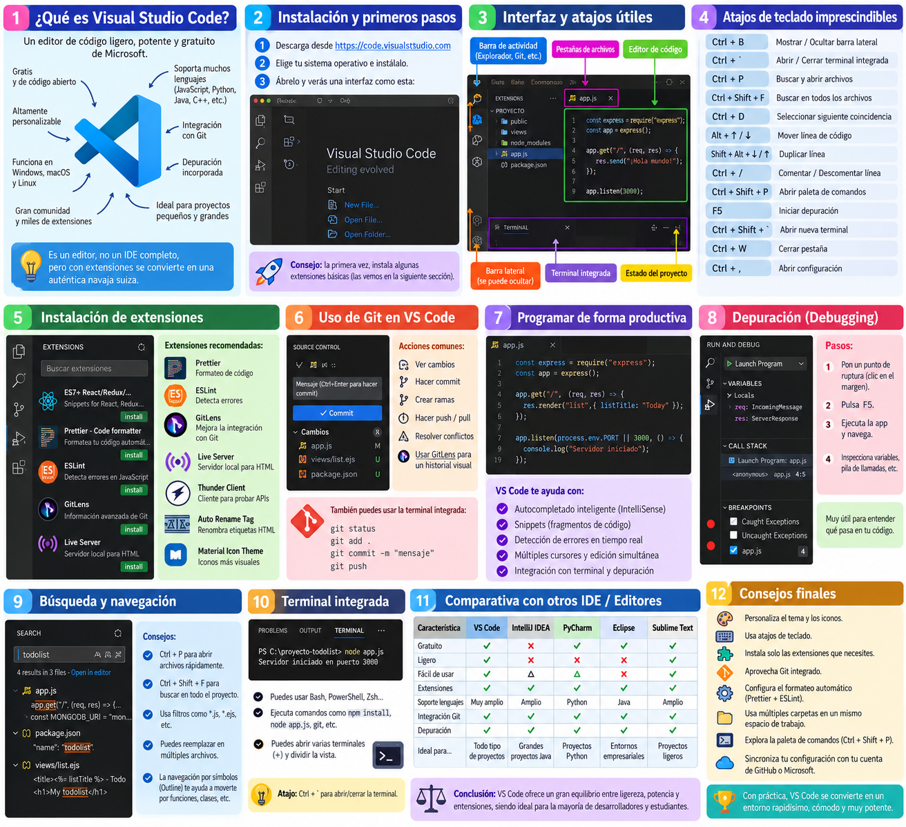

# 💻 Visual Studio Code: El Manual Definitivo de Productividad, Git y Depuración
### *Curso Profundo, Didáctico y 100% Práctico con Laboratorios Interactivos y Retos de Código*

---

> **¿Por qué este curso es diferente?**  
> Casi todos los programadores usan Visual Studio Code hoy en día, pero la inmensa mayoría lo utiliza como si fuera un simple "Bloc de Notas con colores": dependen obsesivamente del ratón, no dominan la paleta de comandos, sufren al resolver conflictos de Git y recurren a decenas de `print()` para encontrar un bug en lugar de usar el depurador visual.
>
> Este manual ha sido diseñado a partir de la **infografía oficial de VS Code** de nuestro bootcamp para transformar radicalmente tu flujo de trabajo. Aquí no solo memorizarás atajos; aprenderás el modelo mental del editor, dominarás la búsqueda quirúrgica, jugarás con Git visual de forma interactiva y aprenderás a programar a la velocidad del pensamiento.

---



---

## 🧭 Índice del Curso

1. [Módulo 1: ¿Qué es Visual Studio Code y por qué domina la industria?](#módulo-1-qué-es-visual-studio-code-y-por-qué-domina-la-industria)
2. [Módulo 2: Instalación, Primeros Pasos y Primer Contacto](#módulo-2-instalación-primeros-pasos-y-primer-contacto)
3. [Módulo 3: Anatomía de la Interfaz: Los 5 Pilares Visuales](#módulo-3-anatomía-de-la-interfaz-los-5-pilares-visuales)
4. [Módulo 4: El Modo Ninja: Atajos de Teclado Imprescindibles](#módulo-4-el-modo-ninja-atajos-de-teclado-imprescindibles)
5. [Módulo 5: Ecosistema de Extensiones: Convirtiendo un Editor en una Estación Espacial](#módulo-5-ecosistema-de-extensiones-convirtiendo-un-editor-en-una-estación-espacial)
6. [Módulo 6: 🎮 Laboratorio de Juego con Git en VS Code](#módulo-6--laboratorio-de-juego-con-git-en-vs-code)
7. [Módulo 7: Programar de Forma Productiva: Multicursores, Snippets y Refactor](#módulo-7-programar-de-forma-productiva-multicursores-snippets-y-refactor)
8. [Módulo 8: 🐛 Laboratorio de Caza de Bugs: Depuración Profesional (Debugging)](#módulo-8--laboratorio-de-caza-de-bugs-depuración-profesional-debugging)
9. [Módulo 9: 🔍 Búsqueda Quirúrgica y Navegación Relámpago](#módulo-9--búsqueda-quirúrgica-y-navegación-relámpago)
10. [Módulo 10: La Terminal Integrada y Multitarea](#módulo-10-la-terminal-integrada-y-multitarea)
11. [Módulo 11: VS Code frente a los Gigantes (Comparativa con IDEs tradicionales)](#módulo-11-vs-code-frente-a-los-gigantes-comparativa-con-ides-tradicionales)
12. [Módulo 12: Configuración Pro, Sincronización y los 10 Hábitos de Oro](#módulo-12-configuración-pro-sincronización-y-los-10-hábitos-de-oro)

---

## Módulo 1: ¿Qué es Visual Studio Code y por qué domina la industria?

### 🎯 La Idea en Humano
Durante décadas, los desarrolladores vivían divididos en dos bandos extremos:
- **Editores ultraligeros pero espartanos** (Notepad++, Sublime Text, Vim, Nano): Arrancaban en 0.2 segundos, pero carecían de depuradores visuales, analizadores de tipos o integración profunda con herramientas de equipo.
- **Entornos de Desarrollo Integrados pesados (IDEs)** (Eclipse, Visual Studio tradicional, NetBeans): Tenían todas las herramientas imaginables, pero consumían gigabytes de memoria RAM, tardaban minutos en abrir un proyecto y su interfaz parecía la cabina de un Boeing 747.

En 2015, Microsoft lanzó **Visual Studio Code (VS Code)**, un proyecto de código abierto construido sobre tecnologías web modernas (Electron, Node.js y TypeScript). Su premisa revolucionó la industria:
> **"Un núcleo ultraligero y rápido como un editor de texto, pero modularmente extensible hasta convertirse en el IDE más avanzado del planeta."**

### 🔬 Características Clave
- **Gratuito y de código abierto (Open Source):** Respaldado por una inmensa comunidad global y por Microsoft.
- **Multiplataforma:** Mismo comportamiento y configuración idéntica en Windows, macOS y Linux.
- **Políglota nativo:** Capaz de editar con precisión milimétrica proyectos híbridos donde conviven Python, SQL, HTML/CSS, JavaScript, Rust, C++ y Markdown.
- **Git integrado en el ADN:** No necesitas instalar plugins de terceros para ver tus ramas, cambios y diferencias visuales.
- **Motor LSP (Language Server Protocol):** Separa el análisis inteligente del código (IntelliSense) de la interfaz gráfica, garantizando fluidez extrema.

---

## Módulo 2: Instalación, Primeros Pasos y Primer Contacto

### 📥 Proceso de Puesta en Marcha
1. Descarga el instalador oficial desde [code.visualstudio.com](https://code.visualstudio.com/).
2. **Durante la instalación en Windows/Linux (Paso Crítico):**
   - Marca la casilla **"Agregar la acción 'Abrir con Code' al menú contextual de archivos y carpetas"**. Esto te permitirá abrir cualquier carpeta de trabajo haciendo clic derecho.
   - Marca **"Agregar a PATH"** para poder lanzar proyectos desde tu terminal con el comando:
     ```bash
     code .
     ```
3. **En macOS:**
   - Abre VS Code, presiona `Cmd + Shift + P`, escribe `Shell Command: Install 'code' command in PATH` y pulsa Enter. Desde ese momento, cualquier terminal te permitirá abrir carpetas al instante.

### 🏁 Pantalla de Bienvenida y Filosofía de Carpetas
VS Code trabaja bajo el concepto de **Workspace (Espacio de Trabajo) basado en Carpetas**. En lugar de crear complejas configuraciones propietarias de proyecto, simplemente abres una carpeta en tu disco (`File > Open Folder...` o `Ctrl + O` / `Cmd + O`) y VS Code reconocerá de inmediato el árbol de archivos, el entorno virtual de Python y el repositorio Git si existe.

---

## Módulo 3: Anatomía de la Interfaz: Los 5 Pilares Visuales

Para controlar VS Code sin esfuerzo visual, debes entender sus 5 áreas neurálgicas:

```
+---+----------------------+----------------------------------------------+
| A |  B. BARRA LATERAL    |  C. GRUPOS DE EDITORES (PESTAÑAS)            |
| C |  (Side Bar)          |                                              |
| T |                      |  def calcular_total(items):                  |
| I |  📁 PROYECTO         |      subtotal = sum(i.precio for i in items) |
| V |  ├── app.py          |      return subtotal * 1.21                  |
| I |  ├── utils.py        |                                              |
| T |  └── README.md       |                                              |
| Y |                      +----------------------------------------------+
|   |                      |  D. PANEL INFERIOR                           |
| B |                      |  [Terminal] [Problems] [Output] [Debug]      |
| A |                      |  (venv) $ python app.py                      |
| R |                      |                                              |
+---+----------------------+----------------------------------------------+
| E. BARRA DE ESTADO (Status Bar): main* | 0 errors | UTF-8 | Python 3.12 |
+-------------------------------------------------------------------------+
```

1. **Barra de Actividad (Activity Bar - Extremo izquierdo):**
   - **Explorador (`Ctrl+Shift+E` / `Cmd+Shift+E`):** Estructura jerárquica de archivos y carpetas.
   - **Búsqueda Global (`Ctrl+Shift+F` / `Cmd+Shift+F`):** Localiza y reemplaza texto en todo el proyecto.
   - **Control de Código Fuente (`Ctrl+Shift+G` / `Cmd+Shift+G`):** Interfaz gráfica de Git.
   - **Ejecutar y Depurar (`Ctrl+Shift+D` / `Cmd+Shift+D`):** El motor de breakpoints y watch.
   - **Extensiones (`Ctrl+Shift+X` / `Cmd+Shift+X`):** Marketplace con miles de extensiones.
2. **Barra Lateral Primaria (Primary Side Bar):** Muestra el contenido del panel seleccionado en la Barra de Actividad. Se oculta o muestra al instante con `Ctrl + B` (`Cmd + B` en Mac).
3. **Área del Editor (Editor Groups):** Soporta múltiples pestañas, pantalla dividida vertical u horizontal (`Ctrl + \` / `Cmd + \`), minimapa a la derecha y migas de pan (*breadcrumbs*) en la parte superior.
4. **Panel Inferior (Panel):**
   - **Terminal:** Consola integrada (Bash, Zsh, PowerShell).
   - **Problems:** Alertas de sintaxis, errores de tipos y advertencias de linters.
   - **Output:** Registros de extensiones y servidores de lenguaje.
   - **Debug Console:** Salida interactiva para evaluar expresiones durante una pausa de ejecución.
5. **Barra de Estado (Status Bar - Fondo de la ventana):**
   - Rama activa de Git y estado de sincronización (flechas de subida/bajada).
   - Conteo de errores y warnings activos.
   - Intérprete activo de Python (¡vital para seleccionar tu `.venv`!).
   - Codificación del archivo (`UTF-8`) y espaciado (espacios vs tabs).

---

## Módulo 4: El Modo Ninja: Atajos de Teclado Imprescindibles

El verdadero salto de nivel como desarrollador ocurre cuando tus manos nunca abandonan el teclado para tareas rutinarias.

### ⚡ Tabla Maestra de Atajos (Windows/Linux vs macOS)

| Acción | Windows / Linux | macOS | ¿Por qué cambia tu vida? |
| :--- | :--- | :--- | :--- |
| **Paleta de Comandos** | `Ctrl + Shift + P` | `Cmd + Shift + P` | Es la nave nodriza: cualquier acción de VS Code se ejecuta desde aquí. |
| **Búsqueda Rápida de Archivos** | `Ctrl + P` | `Cmd + P` | Abre cualquier archivo en 1 segundo escribiendo parte de su nombre. |
| **Mostrar / Ocultar Barra Lateral** | `Ctrl + B` | `Cmd + B` | Gana el 100% de la pantalla para concentrarte en el código. |
| **Abrir / Cerrar Terminal** | `Ctrl + \`` | `Cmd + \`` | Abre la consola sin tocar el ratón y la oculta cuando terminas. |
| **Buscar en Todo el Proyecto** | `Ctrl + Shift + F` | `Cmd + Shift + F` | Rastreo global con soporte de expresiones regulares y filtros. |
| **Multicursor por Coincidencia** | `Ctrl + D` | `Cmd + D` | Selecciona la siguiente palabra idéntica y edítalas todas a la vez. |
| **Mover Línea Arriba / Abajo** | `Alt + ↑ / ↓` | `Option + ↑ / ↓` | Desplaza bloques de código sin necesidad de cortar y pegar. |
| **Duplicar Línea Arriba / Abajo** | `Shift + Alt + ↑ / ↓` | `Shift + Option + ↑ / ↓` | Clona líneas instantáneamente. |
| **Comentar / Descomentar Línea** | `Ctrl + /` | `Cmd + /` | Comenta o descomenta automáticamente según la sintaxis del lenguaje. |
| **Cerrar Pestaña Actual** | `Ctrl + W` | `Cmd + W` | Limpia tu área de trabajo rápidamente. |
| **Dividir Editor en Dos** | `Ctrl + \` | `Cmd + \` | Compara o edita dos archivos lado a lado. |
| **Abrir Configuración (Settings)** | `Ctrl + ,` | `Cmd + ,` | Acceso directo a preferencias del usuario y del proyecto. |
| **Renombrar Símbolo Seguro** | `F2` | `F2` | Cambia el nombre de una variable o función en **todos los archivos** donde se use. |

---

## Módulo 5: Ecosistema de Extensiones: Convirtiendo un Editor en una Estación Espacial

VS Code viene "limpio", pero con 5 minutos de configuración se convierte en una herramienta insuperable.

```
       ┌────────────────────────────────────────────────────────┐
       │             VS CODE CORE (Ligero y Rápido)             │
       └──────────────────────────┬─────────────────────────────┘
                                  │
     ┌──────────────────┬─────────┴────────┬──────────────────┐
     ▼                  ▼                  ▼                  ▼
┌──────────────┐ ┌──────────────┐ ┌──────────────────┐ ┌──────────────┐
│   LENGUAJE   │ │   CALIDAD    │ │   CONTROL GIT    │ │  ESTÉTICA &  │
│ Python (MS)  │ │   Prettier   │ │     GitLens      │ │ HERRAMIENTAS │
│   Pylance    │ │     Ruff     │ │ (Blame, History, │ │Material Icons│
│     Ruff     │ │    ESLint    │ │  Branch Compare) │ │ ThunderClient│
└──────────────┘ └──────────────┘ └──────────────────┘ └──────────────┘
```

### 🌟 El Kit de Oro Recomendado

1. **Python + Pylance (Microsoft):** Indispensable. Autocompletado inteligente con inferencia de tipos, navegación a definiciones (`F12`), inspección de docstrings y detección de errores antes de ejecutar.
2. **Ruff (Astral Software):** El linter y formateador de Python más rápido del mundo. Reemplaza a Flake8, Black, isort y Pylint en milisegundos.
3. **Prettier - Code Formatter:** El estándar de la industria para formatear código limpio en HTML, CSS, JavaScript, JSON y Markdown automáticamente al guardar.
4. **GitLens — Git supercharged:** Añade a cada línea de código el autor y el commit exacto que la modificó (*Git blame annotations*), explorador visual de commits y comparación gráfica de ramas.
5. **Thunder Client:** Un cliente de pruebas HTTP y REST API ultraligero integrado dentro de VS Code (evita tener que abrir herramientas pesadas externas como Postman).
6. **Live Server:** Lanza un servidor local instantáneo para tus proyectos web con recarga en tiempo real (*live-reload*) cada vez que guardas un archivo HTML/CSS.
7. **Material Icon Theme:** Asigna iconos nítidos y reconocibles a cada extensión (`.py`, `.sql`, `.md`, `.json`, `.sh`), facilitando la lectura visual del proyecto.

---

## Módulo 6: 🎮 Laboratorio de Juego con Git en VS Code

> [!TIP]
> **Filosofía**: La interfaz visual de Git en VS Code no sustituye a la terminal: **la potencia y la complementa**. Donde la terminal te obliga a imaginar diferencias de texto, VS Code te ofrece una experiencia visual de precisión quirúrgica.

Vamos a realizar una serie de ejercicios prácticos donde crearemos un repositorio de pruebas, exploraremos la codificación por colores de VS Code, haremos commits visuales, seleccionaremos líneas específicas (*staging parcial*) y resolveremos un conflicto de merge provocado a propósito.

---

### 🕹️ Juego 1: El Tablero de Colores de Git en el Explorador

Abre una terminal en VS Code (`Ctrl + \`` / `Cmd + \``) y ejecuta estos comandos para preparar un campo de juego aislado:

```bash
# 1. Crear carpeta de pruebas dentro de tu sandbox y entrar en ella
mkdir -p /tmp/vscode_git_playground && cd /tmp/vscode_git_playground

# 2. Inicializar repositorio Git
git init

# 3. Abrir esta carpeta en una nueva ventana de VS Code
code .
```

Crea tres archivos vacíos desde el Explorador de VS Code:
1. `servidor.py`
2. `config.json`
3. `notas.txt`

#### 👁️ Observa el Explorador de Archivos:
- Verás que los tres nombres aparecen en **verde** con una letra **`U`** a la derecha.
  * **`U` (Untracked):** El archivo es nuevo en el disco y Git aún no lo rastrea.
- Ve a la pestaña **Control de Código Fuente (Source Control)** con `Ctrl + Shift + G` (`Cmd + Shift + G`).
- Verás los 3 archivos bajo la sección **Changes (Cambios)**.

---

### 🕹️ Juego 2: Staging Visual y Commits con un Clic

En lugar de teclear `git add .`:
1. Pasa el ratón por encima de `servidor.py` en la lista de Cambios.
2. Haz clic en el icono **`+` (Stage Changes)** que aparece a la derecha del archivo.
   - Observa cómo `servidor.py` salta a una nueva sección: **Staged Changes (Cambios preparados)**.
   - En el explorador, la letra cambia a **`A` (Added)**.
3. Haz clic en el botón `+` superior (junto al título "Changes") para preparar todos los archivos a la vez.
4. En la caja de texto superior escribe:
   ```text
   feat: inicializar estructura del proyecto
   ```
5. Pulsa el botón azul **Commit** (o presiona el atajo `Ctrl + Enter` / `Cmd + Enter`).
   - ¡Listo! Tu primer commit visual ha quedado sellado. La lista de cambios queda limpia.

---

### 🕹️ Juego 3: Diff Interactivo y Staging Quirúrgico por Líneas (Hunk Staging)

Edita el archivo `servidor.py` y pega el siguiente código:

```python
# Servidor Principal
def iniciar_servidor():
    puerto = 8080
    print(f"Servidor escuchando en el puerto {puerto}")

def funcion_experimental_no_terminada():
    # Esto todavía está a medias, no quiero guardarlo aún
    x = 10 / 0
```

Guarda el archivo (`Ctrl + S` / `Cmd + S`).

1. Observa el explorador: el archivo ahora aparece en color **naranja / amarillo** con una letra **`M` (Modified)**.
2. En el margen izquierdo del editor de código (junto a los números de línea), verás una **barra vertical azul**. Esa barra indica líneas modificadas. Si hubieras agregado líneas nuevas, verías una barra **verde**.
3. Haz clic en `servidor.py` dentro de la pestaña de **Source Control**:
   - Se abrirá la **Vista de Diferencias (Diff View)** en dos columnas: a la izquierda la versión anterior y a la derecha tu versión actual.
4. **El Superpoder de VS Code (Stage Selected Ranges):**
   - Selecciona con el ratón únicamente las líneas 1 a 4 (la función `iniciar_servidor`).
   - Haz clic derecho sobre la selección y elige: **"Stage Selected Ranges" (Preparar rangos seleccionados)**.
   - ¿Qué ha ocurrido? Has preparado para commit **solo las líneas terminadas**, dejando fuera el código experimental que rompería el programa.
   - Haz commit con el mensaje: `feat: agregar inicio de servidor`.

---

### 🕹️ Juego 4: Provocar y Resolver un Conflicto de Merge Visualmente

Los conflictos de Git aterrorizan a los principiantes. En VS Code, resolver un conflicto es un juego interactivo de botones.

#### Paso A: Preparar la rama principal
En `servidor.py`, modifica el puerto para que sea `3000`:
```python
def iniciar_servidor():
    puerto = 3000
    print(f"Servidor escuchando en el puerto {puerto}")
```
Guarda y haz commit en la rama `main`:
- Mensaje: `fix: cambiar puerto a 3000 en main`

#### Paso B: Crear una rama secundaria con un cambio incompatible
1. Mira la **Barra de Estado** abajo a la izquierda. Verás el icono de Git con el nombre de tu rama actual (`main` o `master`).
2. Haz clic sobre el nombre de la rama. Se abrirá la paleta de comandos arriba.
3. Selecciona **"Create new branch..." (Crear nueva rama...)**, nómbrala `feature/puerto-seguro` y pulsa Enter.
4. Ahora estás en la nueva rama. Cambia el puerto a `8443`:
```python
def iniciar_servidor():
    puerto = 8443  # Puerto HTTPS seguro
    print(f"Servidor escuchando en el puerto {puerto}")
```
5. Guarda y haz commit:
   - Mensaje: `feat: usar puerto 8443 seguro en feature`

#### Paso C: Volver a main y fusionar para desatar el conflicto
1. Vuelve a hacer clic en la barra de estado y selecciona la rama `main`.
2. Abre la terminal (`Ctrl + \``) o la paleta de comandos (`Ctrl + Shift + P`) y ejecuta:
   ```bash
   git merge feature/puerto-seguro
   ```
3. **¡Alerta de Conflicto!** Git te informará de un conflicto de combinación en `servidor.py`.

#### Paso D: La Magia del Asistente Visual de VS Code
Abre `servidor.py`. Verás que VS Code resalta el conflicto con bloques de colores y te ofrece 4 botones flotantes mágicos:

```text
<<<<<<< HEAD (Current Change)
    puerto = 3000
=======
    puerto = 8443  # Puerto HTTPS seguro
>>>>>>> feature/puerto-seguro (Incoming Change)
```

Directamente sobre el código verás los botones:
- **Accept Current Change:** Mantiene lo que tenías en `main` (`3000`).
- **Accept Incoming Change:** Acepta lo que viene de la rama `feature` (`8443`).
- **Accept Both Changes:** Mantiene ambas líneas una tras otra.
- **Compare Changes:** Abre el diff interactivo para analizar el contexto.
- **Resolve in Merge Editor:** Abre la interfaz avanzada a 3 pantallas (*Current*, *Incoming* y *Result* final interactivo).

1. Haz clic en **"Accept Incoming Change"**.
2. Verás cómo VS Code borra automáticamente los marcadores `<<<<<<<`, `=======` y `>>>>>>>`, dejando el código limpio con `puerto = 8443`.
3. Ve a Source Control, haz clic en el `+` para preparar el archivo resuelto y pulsa **Commit**.
4. ¡Conflicto resuelto en 5 segundos sin estrés!

---

## Módulo 7: Programar de Forma Productiva: Multicursores, Snippets y Refactor

### 🧙‍♂️ 1. Multicursores: Multiplica tu Velocidad por Diez

Imagina que tienes una lista de datos en bruto que debes convertir en variables o claves de diccionario:

```python
nombre
apellido
correo
telefono
ciudad
```

#### Práctica de Multicursores:
1. **Multicursor libre con ratón:** Mantén pulsada la tecla `Alt` (u `Option` en Mac) y haz clic al principio de cada una de las 5 palabras. ¡Ahora tienes 5 cursores parpadeando al mismo tiempo!
2. Escribe `usuario_` y observa cómo se escribe simultáneamente en las 5 líneas.
3. **Multicursor por coincidencia (`Ctrl + D` / `Cmd + D`):**
   - Sitúa el cursor sobre una palabra repetida.
   - Pulsa `Ctrl + D`: se selecciona esa palabra.
   - Pulsa `Ctrl + D` otra vez: se añade a la selección la siguiente coincidencia.
   - Pulsa `Ctrl + D` cuantas veces quieras. Cada vez que escribas o borres, afectará a todas las instancias seleccionadas.
4. **Column Selection (Selección en Bloque):**
   - Presiona `Shift + Alt` (Windows/Linux) o `Shift + Option` (Mac) y arrastra con el ratón hacia abajo para seleccionar una columna perfecta de caracteres.

---

### 🧩 2. Snippets Inteligentes
Escribir código repetitivo es una pérdida de tiempo. Escribe en un archivo Python:
```python
def
```
Pulsa `Tab`. VS Code desplegará la plantilla completa de función con parámetros y docstring. Puedes crear tus propios snippets en `File > Preferences > Configure Snippets`.

---

### 🔄 3. Refactorización Segura con F2
Nunca uses "Buscar y reemplazar texto" para cambiar el nombre de una función o variable, porque podrías cambiar comentarios o palabras que coincidan en otros textos.
- Coloca el cursor sobre la función `iniciar_servidor`.
- Presiona **`F2`**.
- Escribe `levantar_servicio_web` y pulsa `Enter`.
- VS Code analizará el árbol sintáctico de todo el proyecto y renombrará el símbolo únicamente donde corresponda, evitando errores humanos.

---

## Módulo 8: 🐛 Laboratorio de Caza de Bugs: Depuración Profesional (Debugging)

> [!CAUTION]
> El 90% de los estudiantes novatos depuran sus programas llenando su código de `print(x)`, `print("aqui 1")`, `print("aqui 2")`. Esto es lento, ensucia el código fuente y no permite ver qué ocurre dentro de la memoria.

VS Code tiene un **depurador visual de primera categoría** integrado sin instalar herramientas externas.

---

### 🔬 Laboratorio de Caza de Bugs Paso a Paso

Crea un archivo llamado `caza_bugs.py` con este código que contiene un error de lógica disimulado:

```python
# caza_bugs.py

def calcular_descuento(precio, porcentaje):
    descuento = precio * (porcentaje / 100)
    total = precio - descuento
    return total

def procesar_pedidos(pedidos):
    totales_procesados = []
    for item in pedidos:
        cliente = item["cliente"]
        subtotal = item["precio"]
        descuento = item.get("descuento", 0)
        
        # Bug: si el descuento es 0, la función calcula mal o queremos auditar
        total_final = calcular_descuento(subtotal, descuento)
        totales_procesados.append({"cliente": cliente, "total": total_final})
    return totales_procesados

datos = [
    {"cliente": "Alicia", "precio": 100, "descuento": 10},
    {"cliente": "Carlos", "precio": 250, "descuento": 20},
    {"cliente": "Beatriz", "precio": 50, "descuento": 50},
]

resultado = procesar_pedidos(datos)
print("Proceso completado:", resultado)
```

---

### 🎯 Pasos para Cazadores de Bugs:

```
          [ Margen ] [ Línea de Código ]
              🔴 10:     descuento = item.get("descuento", 0)
              │
              └─► Punto de ruptura (Breakpoint)
```

1. **Poner un Punto de Ruptura (Breakpoint):**
   - Ve a la línea 15 (`total_final = calcular_descuento(subtotal, descuento)`).
   - Haz clic a la izquierda del número de línea en el margen gris.
   - Aparecerá un **círculo rojo brillante 🔴**. Ese es tu breakpoint: le estás diciendo a Python *"Detén el universo justo antes de ejecutar esta línea"*.

2. **Lanzar la Depuración:**
   - Pulsa la tecla **`F5`** (o ve a la barra lateral de **Run and Debug** `Ctrl+Shift+D` y pulsa "Run and Debug").
   - Elige **"Python Debugger: Python File"**.
   - El programa arrancará y se detendrá congelado en la línea 15, resaltándola en amarillo.

3. **Inspección de Variables (Panel izquierdo):**
   - Mira el panel **Variables > Locals**:
     * Verás el valor exacto en tiempo real de `cliente: 'Alicia'`, `subtotal: 100`, `descuento: 10`.
   - Coloca el puntero del ratón sobre la palabra `subtotal` en el editor: ¡aparecerá una ventana flotante con su valor actual!

4. **La Botonera de Control de Depuración (Flotante arriba al centro):**
   - ▶️ **Continue (`F5`):** Reanuda la ejecución hasta encontrar el siguiente breakpoint (pasará al cliente Carlos).
   - ↷ **Step Over (`F10`):** Ejecuta la línea actual y pasa a la siguiente sin entrar al interior de la función.
   - ⤶ **Step Into (`F11`):** ¡Entra dentro de `calcular_descuento`! Puedes ver cómo se calcula `precio * (porcentaje / 100)` paso a paso.
   - ⤴️ **Step Out (`Shift + F11`):** Sale de la función actual y vuelve a la línea donde fue llamada.
   - 🔄 **Restart (`Ctrl + Shift + F5`):** Reinicia la sesión de depuración desde cero.
   - ⏹️ **Stop (`Shift + F5`):** Detiene la depuración por completo.

5. **Puntos de Ruptura Condicionales (Técnica Pro):**
   - Haz clic derecho sobre el círculo rojo 🔴 y elige **"Edit Breakpoint..."**.
   - Escribe la condición: `cliente == "Beatriz"`.
   - Ahora el depurador no se detendrá ni con Alicia ni con Carlos; se pausará **únicamente cuando el bucle llegue a Beatriz**. ¡Ahorro de horas de depuración en listas de miles de elementos!

---

## Módulo 9: 🔍 Búsqueda Quirúrgica y Navegación Relámpago

Cuando trabajas en repositorios profesionales con cientos de archivos, navegar haciendo clic en carpetas es ineficiente.

```
       BÚSQUEDA RÁPIDA (Ctrl + P)
       ┌──────────────────────────────────────────────────────────┐
       │ > main.py                                                │
       │   src/controllers/main.py                                │
       │   tests/unit/test_main.py                                │
       └──────────────────────────────────────────────────────────┘

       PALETA DE SÍMBOLOS (Ctrl + Shift + O)
       ┌──────────────────────────────────────────────────────────┐
       │ @calcular_descuento (Línea 3)                           │
       │ @procesar_pedidos (Línea 8)                              │
       └──────────────────────────────────────────────────────────┘
```

### 🎯 1. Búsqueda Rápida de Archivos (`Ctrl + P` / `Cmd + P`)
Escribe fragmentos del nombre del archivo. Por ejemplo, teclear `apppy` te abrirá `application/core/app.py`.
- Si añades `:42` al final (`Ctrl + P` -> `servidor.py:42`), VS Code abrirá el archivo y te llevará directamente a la **línea 42**.

### 🎯 2. Búsqueda Global y Expresiones Regulares (`Ctrl + Shift + F`)
Pulsa `Ctrl + Shift + F` (`Cmd + Shift + F` en Mac) para buscar en todos los archivos de tu proyecto:
- **Botón `.*` (Regex):** Permite buscar patrones como `logger\.(error|warning)\(.*\)`.
- **Filtro `files to include`:** Busca solo en archivos específicos (ej: `*.py` o `src/**`).
- **Filtro `files to exclude`:** Excluye carpetas ruidosas (ej: `node_modules, .venv, *.log`).
- **Reemplazo Masivo:** Pulsa la flecha desplegable, escribe el texto de sustitución y reemplaza en 50 archivos simultáneamente con un solo clic tras previsualizar los cambios.

### 🎯 3. Navegación por Símbolos (Outline y Breadcrumbs)
- **`Ctrl + Shift + O` (`Cmd + Shift + O`):** Muestra todas las funciones, clases y métodos del archivo actual. Escribiendo `:` se agrupan por categorías (funciones, variables, constantes).
- **`Ctrl + T` (`Cmd + T`):** Busca cualquier función o clase en **todo el espacio de trabajo**, sin importar en qué archivo esté guardada.
- **`F12` (Go to Definition):** Salta instantáneamente al archivo y línea exacta donde se declaró la función o clase bajo tu cursor.
- **`Alt + F12` (Peek Definition):** Abre una ventana emergente dentro de tu archivo actual para ver la definición sin necesidad de cambiar de pestaña.

---

## Módulo 10: La Terminal Integrada y Multitarea

La terminal integrada de VS Code (`Ctrl + \`` / `Cmd + \``) elimina la necesidad de alternar constantemente entre ventanas externas.

### 🚀 Trucos de Terminal de Alta Productividad:
1. **Múltiples Terminales Simultáneas:**
   - Pulsa el botón `+` para abrir una segunda terminal (por ejemplo, una corriendo el servidor web y otra ejecutando tests).
2. **Terminales Divididas (Split Terminal):**
   - Pulsa el botón de división o usa `Ctrl + \` dentro de la terminal. Tendrás dos consolas lado a lado en el mismo panel inferior para vigilar la base de datos y la API simultáneamente.
3. **Detección Automática de Entornos Virtuales (`.venv`):**
   - Si tienes una carpeta `.venv` en la raíz de tu proyecto, cada vez que abras una nueva terminal integrada, VS Code activará automáticamente el entorno virtual (`source .venv/bin/activate` o Windows equivalente) sin que tengas que teclear nada.
4. **Maximizar y Restaurar:**
   - Haz doble clic en la pestaña "TERMINAL" o pulsa la flecha hacia arriba para que la terminal ocupe toda la pantalla cuando necesites leer logs extensos.

---

## Módulo 11: VS Code frente a los Gigantes (Comparativa con IDEs tradicionales)

| Característica | Visual Studio Code | PyCharm Professional | IntelliJ IDEA | Sublime Text | Eclipse |
| :--- | :---: | :---: | :---: | :---: | :---: |
| **Precio** | **Gratuito / Open Source** | De pago (suscripción) | De pago (versión Ultimate) | De pago (licencia) | Gratuito |
| **Consumo de Memoria RAM** | **Moderado (~300 - 800 MB)** | Alto (~1.5 - 3 GB) | Muy Alto (~2 - 4 GB) | **Mínimo (~50 - 150 MB)** | Alto (~1.5 GB) |
| **Tiempo de Arranque** | **Rápido (1-3 seg)** | Lento (10-25 seg) | Lento (15-30 seg) | **Instantáneo (<0.5 seg)** | Lento (15-40 seg) |
| **Soporte Políglota** | **Excelente (miles de lenguajes)**| Especializado en Python | Especializado en Java/JVM | Bueno (vía paquetes) | Complejo |
| **Git Integrado** | **Nativo visual + GitLens** | Excelente (nativo) | Excelente (nativo) | Básico (requiere Sublime Merge) | Anticuado |
| **Ecosistema de Extensiones** | **El más grande del mundo** | Amplio (JetBrains Marketplace) | Amplio (JetBrains) | Medio (Package Control) | Antiguo / Complejo |
| **Ideal para...** | **Todo tipo de proyectos y estudiantes** | Equipos dedicados 100% a Python puro | Proyectos empresariales Java masivos | Edición relámpago de scripts | Proyectos legados Java |

> [!NOTE]
> **Veredicto:** VS Code ofrece el equilibrio perfecto entre la ligereza de un editor de texto y la potencia de un IDE profesional, convirtiéndose en el estándar indiscutible para bootcamps y empresas tecnológicas punteras.

---

## Módulo 12: Configuración Pro, Sincronización y los 10 Hábitos de Oro

### ⚙️ Automatización en `.vscode/settings.json`
Dentro de la carpeta de tu proyecto puedes crear un archivo `.vscode/settings.json` para que todo tu equipo comparta las mismas reglas de formateo y estilo:

```json
{
  "editor.formatOnSave": true,
  "editor.defaultFormatter": "charliermarsh.ruff",
  "editor.codeActionsOnSave": {
    "source.organizeImports": "always",
    "source.fixAll": "always"
  },
  "editor.rulers": [88, 100],
  "editor.minimap.enabled": false,
  "editor.bracketPairColorization.enabled": true,
  "files.trimTrailingWhitespace": true,
  "files.insertFinalNewline": true
}
```

### ☁️ Sincronización de Preferencias (Settings Sync)
No vuelvas a configurar tus atajos, temas y extensiones a mano cuando cambies de ordenador:
1. Haz clic en el engranaje abajo a la izquierda (`⚙️`).
2. Selecciona **"Turn on Settings Sync..."**.
3. Inicia sesión con tu cuenta de **GitHub**.
4. A partir de ese instante, cualquier cambio en tus atajos o extensiones se sincronizará automáticamente en tu portátil, tu ordenador de sobremesa o entornos en la nube como GitHub Codespaces.

---

### 🏆 Los 10 Hábitos de Oro del Desarrollador Profesional en VS Code

1. **Usa `Ctrl + P` en vez de buscar archivos en el árbol del explorador con el ratón.** Ahorrarás más de 15 minutos al día.
2. **Domina la Paleta de Comandos (`Ctrl + Shift + P`).** Si no recuerdas el atajo de una función, búscala aquí.
3. **Formatea al guardar (`formatOnSave`).** Deja que herramientas como Ruff o Prettier limpien tu código por ti.
4. **Aprende a amar los multicursores (`Ctrl + D` y `Alt + Clic`).** Es el superpoder que más asombra en las pruebas técnicas de trabajo.
5. **Aprovecha el Diff visual de Git antes de cada commit.** Revisa exactamente lo que vas a subir; no hagas commits a ciegas.
6. **Usa el Staging parcial por líneas.** Haz commits pequeños y atómicos que cuenten una historia clara.
7. **Abandona el `print()` para depurar:** Pon breakpoints con `F5` y usa breakpoints condicionales.
8. **Selecciona siempre el Intérprete correcto de Python:** Verifica en la Barra de Estado que apunte a tu `.venv`.
9. **Instala solo las extensiones que realmente uses.** Demasiadas extensiones ralentizan el arranque y consumen memoria innecesaria.
10. **Aprende un atajo nuevo cada semana.** La velocidad de edición libera espacio en tu cerebro para concentrarte en lo verdaderamente importante: **resolver problemas con lógica impecable**.
